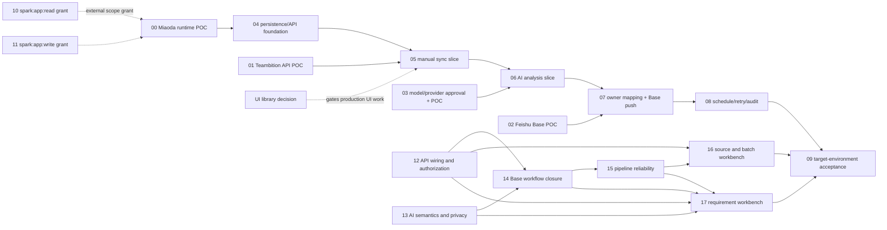

# RQ-Sys MVP — Ticket Drafts

来源：`specs/rq-sys-mvp/`，以当前 PRD revision 60 为产品行为基线。此处是本地待评审 ticket 草案，尚未发布到外部 tracker。

Agent 可直接使用的总任务说明：[`../AGENT-HANDOFF.md`](../AGENT-HANDOFF.md)。

技术栈建议见 [`../../../specs/rq-sys-mvp/TECHNICAL-PLAN-MIAODA.md`](../../../specs/rq-sys-mvp/TECHNICAL-PLAN-MIAODA.md)；首个 POC 需核对 GitHub 仓库与妙搭之间的代码导入/发布方式。

## 建议顺序

先并行验证外部依赖，再按纵向切片开发：

## Ticket list

| ID | Ticket | Status | Depends on |
|---|---|---|---|
| 00 | Miaoda runtime capability POC | partially-available（最新 release `7696725123818540278` 已 finished，绑定 `d64d309ef49cf55bb5011fc348759e58df936c72`，错误日志为空；Online UI/API/目录读取通过，Dev 合成 E2E/目录 CRUD 通过；内嵌预览与组合安全调度仍未完全验收。） | — |
| 01 | Teambition API and field mapping POC | partially verified（2026-10-13 原始接口返回 311 条、311 个非空唯一 ID；Dev source-only 批次 311/311 成功且逐项匹配持久化需求。历史 UI `311/314` 不再是当前 Dev 对齐差异；旧分母由分页数据计算，历史多出的 3 条没有独立识别。字段类型/绑定及更大数据集的分页完整性仍待核实。） | — |
| 02 | Feishu Base schema, upsert, and automation POC | partially verified（本轮官方 Bitable v1 app-token 读取命中合成记录；负责人自动化日志显示仅通知当前用户的步骤成功。该证据仍不等同发布版 Miaoda runtime 的完整 app-mediated E2E；正式表优先级选项仅 P0/P1/P2。） | — |
| 03 | AI provider and data-policy decision/POC | done（2026-10-08 离线校验 5/5 + 超时/无效 key 在线实测 + PII 掩码断言；2026-10-09 有效 key 补跑 T1–T3 全部通过 + 生产适配器冒烟通过并修复 factory env 断链/prompt 样例缺失，证据：specs/rq-sys-mvp/AI-ANALYSIS-POC.md） | D-06 已确认；T1–T3 已验证 |
| 04 | Persisted domain model and server API foundation | implemented-partially-target-verified（Dev 已回读 7 人 owner list 和 54 个模块的已发布字典版本；API/数据库其他路径仍需发布版 E2E 验收。） | 00 |
| 05 | Manual Teambition sync vertical slice | implemented-target-data-aligned（Dev `source_only` 批次 `2d372363-31f5-482a-aca9-4c26cb43010c`：311/311 成功、0 失败、0 缺失真实需求；Dev 保留 7 条合成夹具。该批次未触发 AI、负责人匹配、Base 推送或通知。） | 00, 01, 04, D-08 |
| 06 | AI analysis vertical slice | implemented-partially-target-verified（2026-10-14 新 Dev 合成批次 `4cd73a7f` 分析成功并推送 POC Base，source/analysis version=1；第二用户与完整正式环境链路仍待验收。详见 09。） | 03, 05 |
| 07 | Owner mapping and Feishu Base push vertical slice | implemented-partially-target-verified（Dev 合成 Base upsert/readback 通过；POC 执行人只分配给贾浩，自动化成功且 19:17 本人私聊实收已查询确认。完整负责人变更/实质更新路径仍按 09 验收。） | 02, 05 |
| 08 | Weekly schedule, retry, and audit | implemented-partially-target-verified（目标 cron 关闭态投递已通过；2026-10-14 平台注入数据库演练中，同过期窗口只创建一 batch/job，探针 worker 退出后真实 Dev worker 接管，attempt=2 成功。持久真实周计划仍关闭；cron 与启用安全测试计划的组合路径未测。详见 09。） | 00, 05, 06, 07 |
| 09 | Target-environment end-to-end acceptance | partially executed（2026-10-15 目录 void 锁结果驱动异常已修复；Dev 人员/模块 CRUD 与关联更名/解除分配通过，临时项清理至原 7 人/54 模块。8 个不支持模块真实目标推送/幂等省略通过；第二用户登录按用户反馈通过。root eb4a4dd 已推 main，app d64d309 已发布，release 7696725123818540278 finished，发布后页面可读。仍余内嵌预览稳定性和组合 cron/持久安全计划；正式计划关闭、无 TB 调用。详见 09。） | 00–08, 12–17 |
| D-08 | Resolve production UI component baseline after repo inspection | resolved（2026-10-08，ADR-001：基线已推送（main，03aef74）并检视——仓库无 UI 依赖，按 design.md 采用 HeroUI v3 + Tailwind；UI 托管方式留待 00） | ADR-001 已产出 |
| 10 | Grant `spark:app:read` user scope for Miaoda apps | resolved（2026-10-09 根因确认：TraeWork 注入凭证遮蔽本地授权；加 `env -u LARKSUITE_CLI_APP_ID -u LARKSUITE_CLI_USER_ACCESS_TOKEN -u LARKSUITE_CLI_BRAND` 后 apps +list/+get/release 与 observability 命令调用成功。member APIs 仍为 feature_not_available；观测数据部分为空/null，详见工单 evidence） | — |
| 11 | Grant `spark:app:write` user scope for Miaoda apps | resolved（2026-10-09 双路径验证：member-add 路径返回 feature_not_available 3340005（该 full_stack app 不支持 CLI 协作者管理，非 scope 问题）；**release-create 路径验证通过**——同一 env -u 前缀下 `+release-create --branch sprint/default --apply-reason` 真实发布成功，release 7694661855108893966 publishing→finished、error_logs 空、无 missing_scope（方案A，用户显式确认；命令 Risk: write 无 --yes 门禁）。spark:app:write 对发布类写操作可用） | — |
| 12 | API wiring, login-only access, and source setup | implemented-not-target-verified（本地实现要求登录、不实现 RQ-Sys app 角色；目标来源写入仍待验证。旧 Dev preview 的 `FORBIDDEN` 与旧客户端文案不能归因为应用角色，需先通过受支持流程发布对齐已测代码，再验证登录用户可创建 schedule-disabled 来源。） | — |
| 13 | AI output semantics, priority rules, and privacy | implemented-not-target-verified（2026-10-09 本地完成：移除证据计数公式，规则 JSON 改为显式 U/M/S/C 评分映射 + 阈值，未发布/未校准规则时 priority 保持 null（buildPriorityRule 返回 null，取值不在映射中不猜测）；maskPii 增补身份证/24 位平台用户 ID/@提及；outbound payload 无姓名/用户 ID/联系方式/凭据的断言测试通过。provider target acceptance remains Ticket 09） | 03 |
| 14 | Complete analysis-to-Base push workflow | implemented-partially-target-verified（新 Dev 合成 app-mediated 分析→Base 推送与记录回读通过；低置信度/无法识别/空优先级不阻止推送。该证据限隔离 POC Base，完整变更与异常路径见 09。） | 02, 12, 13 |
| 15 | Pipeline idempotency, retry, and worker fencing | implemented-partially-target-verified（目标相同错窗幂等、探针 worker 退出后租约接管通过；真实服务重启后独立 Dev 冷加载通过。组合 cron/持久安全测试计划路径仍待验收；详见 09。） | 12, 14 |
| 16 | Source settings and batch workbench | implemented-partially-target-verified（正式设置 09:01→09:00 保存读回一致；Dev 独立入口需求/批次 API 与合成入口通过。内嵌编辑器预览重载仍间歇失败；正式周计划关闭。） | 12, 15 |
| 17 | Requirement, owner mapping, retry, and audit workbench | implemented-partially-target-verified（正式需求/批次/映射/审计与 7 人/54 模块可读；Dev 独立冷加载后需求池可读，新合成 AI→Base 通过。2026-10-15 Dev 目录 CRUD 与关联更新全路径通过；第二用户登录按反馈通过，另一账号全操作未独立复测。） | 12–15 |

`ready-for-agent` 表示可开始做 POC/决策工作，不代表生产集成已具备条件。具体 blocker 在各 ticket 中列出。全生命周期 28 字段不属于这些 tickets。

最新状态（2026-10-15）：目录写入故障已复现并修复，root `eb4a4dd` 已获准推送 main，app `d64d309` 已推送并通过 release `7696725123818540278` 发布（finished、错误日志为空）。Dev 目录 CRUD 全路径及关联人员更名/删除通过；临时项清理后 SQL 证实 7 人/54 模块、字典 v6 与 v1 entries 相同、0 活动作业/启用计划。8 个模块通过真实 push service/transport 的省略与幂等重放测试；分析版本来自受控夹具，不是模型语义质量测试。第二用户登录按“已登录”反馈记录通过。根 API 254/254、Web 43/43、Miaoda 73/73 及构建/类型/对齐检查通过。Online 发布后 API 与目录读取通过。剩余内嵌预览生命周期和组合 cron/持久安全来源测试，正式计划关闭，无 TB 请求。详见 09。

历史状态（2026-10-14 追加）：CLI 既有登录可用，Keychain 错误通过正常沙箱外执行解除。新 Dev fixture 批次 `4cd73a7f` 1/1 成功、AI→POC Base 读回通过；本人 19:17 私聊消息已只读查询确认。目标错窗幂等与探针进程退出后的租约接管批次 `80d4d908` 1/1 成功、attempt=2、单 job/源快照/Base 行。服务 PID 2003→4616 后独立 Dev 地址连续两次冷加载通过，需求池正常、总览 311/311；编辑器内嵌预览刷新仍间歇失败，尚未取得该次 HTTP 状态/响应体。Dev 311 TB + 10 夹具、0 活动 job/batch、7 人/54 模块、0 优先级规则/启用计划；云端与本地 62 个业务文件一致。剩余为内嵌预览稳定性、第二用户、不支持模块目标推送、省略和组合 cron/安全计划覆盖。详细证据见 09；正式周计划和干系人通知保持关闭，无产品代码/发布或 TB 请求。

历史状态（2026-10-14，已由上方追加记录更新）：正式版工作台 API 可连接，需求/批次/负责人映射/审计页面可读取；来源设置 09:01 写入并恢复周一 09:00 后均从 API 回读一致，同步与周计划保持关闭。人员目录 7 人、功能模块 54 项可读，视觉空态复核通过。Dev 预览文档 GET `https://ecn8egz1lhkq-app_17fqkjwyx1u-1877652261857433.aiforce.run/app/app_17fqkjwyx1u?locale=en_US` 曾返回 400 `ErrorSandboxNotRunning`（`biz_status:toStart`）。原编辑页、新 Chrome 标签、整页重载、应用入口新标签及预览内“重新加载”均未恢复沙箱；最后一次应用级重载 15 秒后回到“应用加载失败”，iframe 为 `about:blank`、页面日志为空、应用级 API 404 未复现。CLI/技能没有沙箱状态或重启命令；无 Cookie/令牌直连得到的 302 是登录派生流程，不作为沙箱状态证据。只读数据库汇总为 318 条需求（311 TB + 7 夹具）、11 批次、0 活动作业、7 人、54 模块。应用 `rqsysWeeklySyncRecovery` 状态 disabled。最新 release `7696073033094450405` 为 `finished`、错误日志数为 0；本轮只读查询成功。root API 253/253、Web 43/43、Miaoda 路由 72/72；两仓 typecheck/build、Miaoda lint/stylelint、alignment、diff check 均通过。未触发真实同步、目标 AI、Base 写入、通知或周计划。当前需妙搭平台恢复该 app 的 Dev sandbox/PreviewProxy；恢复后才能捕获页面/API 请求并继续 app-mediated E2E、错窗恢复、durable worker 重启和第二用户登录验收。正式周计划与干系人通知保持关闭。
