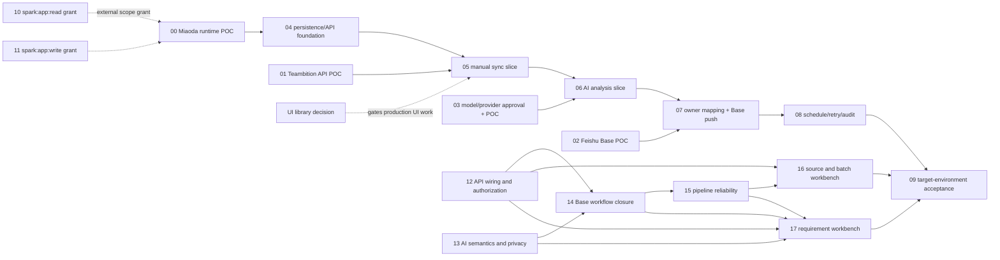

# RQ-Sys MVP — Ticket Drafts

来源：`specs/rq-sys-mvp/`，以当前 PRD revision 60 为产品行为基线。此处是本地待评审 ticket 草案，尚未发布到外部 tracker。

## 最新验收状态（2026-10-18）

负责人修复5434ed2已发布（release7697920647795690499 finished），Online搜索/身份转换/映射保存通过。真实Base更新发现1254061数字字段类型错误；已按正式number/POC text实现schema序列化并补齐限流链路，本地API289/Web45/Miaoda86通过，待新修复发布和3条记录回读。正式通知与周计划保持关闭。剩余只保留R1真实推送闭环、R2通知开发/补发、R3当前版本隔离定时复验，见[发布收尾清单](../../../specs/rq-sys-mvp/RELEASE-CLOSEOUT.md)。

2026-10-18 本地全量复验通过：root API 286/286、Web 45/45；typecheck、build、`git diff --check`、两仓共用模块对齐 21/21 通过；Miaoda 路由验收79/79及类型、lint、stylelint、build通过。线上续验复现负责人搜索503；对应线上日志的上游状态 unresolved，Online release仍运行旧 commit `ad4620a`，安全诊断 commit `146d918` 未发布，故具体是应用权限/数据范围、凭据还是网络仍未知。实际发布受 `--yes` 门禁阻塞，未绕过。Dev 搜索返回400，与Online错误不同；编辑器重连后恢复但沙箱长期稳定性未证明。正式通知、周计划和恢复 cron 均关闭，没有同步 TB、写 Base 或发干系人消息；通知补发无失败样本。root `application/ports.ts` 对齐修复尚未提交。第二用户人员 CRUD不属验收范围，优先级校准规则留空是已接受决策。MVP尚未全量验收。详情见 [09验收](./09-target-acceptance.md) 和 [验收状态](../../../specs/rq-sys-mvp/LOCAL-AND-TARGET-STATUS.md)。

2026-10-16 最新复核：3 条已导入真实需求 AI 分析成功（模块分别为训练-课程训练/训练-模拟路线/偏好设置；置信度中/高/中；优先级留空），Online 与 Dev 页面都显示“已分析 / 待匹配 / 等待推送”。Online 负责人搜索 `GET /api/feishu/users` 为 HTTP 503，仍未映射/推送。安全诊断代码 commit `146d918` 已推送 `sprint/default`，本地 79/79 路由回归及构建检查通过；release dry-run 已核对，实际发布被自动审批拦截（要求 CLI 不支持的 `--yes`），未绕过，故 Online 还没有具体上游错误诊断。隔离 POC 已有5条本人测试消息通过只读回读，确认正常发送/本人收件；没有失败样本，补发机制和失败概率仍未知。周计划/恢复 cron 与正式通知保持关闭；历史 10月15日组合调度曾通过，10月16日获批观察窗未触发。Dev 独立预览本次可加载且 API 已连接；此前 `ErrorSandboxNotRunning` 未复现，但长期稳定性/根因未证明。用户确认 311→314 来自新增需求；旧 `314/317` 口径未复核。第二用户人员 CRUD 不属验收要求；仅有另一成员登录反馈。MVP 尚未全量验收。详情见 [09验收](./09-target-acceptance.md) 和 [验收状态](../../../specs/rq-sys-mvp/LOCAL-AND-TARGET-STATUS.md)。

Agent 可直接使用的总任务说明：[`../AGENT-HANDOFF.md`](../AGENT-HANDOFF.md)。

技术栈建议见 [`../../../specs/rq-sys-mvp/TECHNICAL-PLAN-MIAODA.md`](../../../specs/rq-sys-mvp/TECHNICAL-PLAN-MIAODA.md)；首个 POC 需核对 GitHub 仓库与妙搭之间的代码导入/发布方式。

## 建议顺序

先并行验证外部依赖，再按纵向切片开发：

## Ticket list

| ID | Ticket | Status | Depends on |
|---|---|---|---|
| 00 | Miaoda runtime capability POC | target runtime path verified（Online 手动合成及 cron/持久安全计划→AI→POC Base通过，配置已恢复；Dev编辑器沙箱/IDE仍间歇失败，保留平台限制。详见09。） | — |
| 01 | Teambition API and field mapping POC | partially verified（历史 API/Dev 快照为311/311；用户说明之后 311→314 的增长来自新增需求。最近 Online/TB source-only 快照314/314 ID一致。独立 UI `314/317` 显示口径尚未复核；字段类型/绑定及更大数据集分页完整性仍待核实。） | — |
| 02 | Feishu Base schema, upsert, and automation POC | push/schema target POC verified（既有POC upsert与独立读回通过；通知能力仅部分通过，正式workflow disabled。原子条件更新、部分收件人精确补发未证明；优先级规则未发布。详见09及通知能力结果。） | — |
| 03 | AI provider and data-policy decision/POC | done（2026-10-08 离线校验 5/5 + 超时/无效 key 在线实测 + PII 掩码断言；2026-10-09 有效 key 补跑 T1–T3 全部通过 + 生产适配器冒烟通过并修复 factory env 断链/prompt 样例缺失，证据：specs/rq-sys-mvp/AI-ANALYSIS-POC.md） | D-06 已确认；T1–T3 已验证 |
| 04 | Persisted domain model and server API foundation | implemented / core target persistence verified（Online实际batch/job/snapshot/analysis/push持久化与Dev目录CRUD通过；其他端点逐项证据见09，不以本地测试替代目标验证。） | 00 |
| 05 | Manual Teambition sync vertical slice | implemented-target-data-aligned（Dev `source_only` 批次 `2d372363-31f5-482a-aca9-4c26cb43010c`：311/311 成功、0 失败、0 缺失真实需求；Dev 保留 7 条合成夹具。该批次未触发 AI、负责人匹配、Base 推送或通知。） | 00, 01, 04, D-08 |
| 06 | AI analysis vertical slice | target verified with synthetic data（Online手动/定时夹具实际模型分析通过；无法识别/低置信度/空优先级不阻塞推送。详见09。） | 03, 05 |
| 07 | Owner mapping and Feishu Base push vertical slice | target POC verified（Online空负责人upsert/readback通过；既有Dev仅本人分配通知实收、8个模块省略与PM字段保护/幂等重放通过。详见09。） | 02, 05 |
| 08 | Weekly schedule, retry, and audit | historical target path verified（10月15日真实cron/安全计划→AI→POC Base通过；本轮新验证窗未产生cron日志或scheduled batch，不能作为当前触发通过证据；恢复 cron/周计划均关闭。错窗/租约接管已验证。详见09。） | 00, 05, 06, 07 |
| 09 | Target-environment end-to-end acceptance | blocked（负责人选人修复已发布并验证；Base数字字段错误已本地修复待发布；发布收敛为R1负责人→Base、R2正式通知开发/失败补发、R3当前版本定时复验与交接。历史计数、第二用户CRUD、接受的字段限制不再重复阻塞；详见RELEASE-CLOSEOUT.md和09。） | 00–08, 12–17 |
| 18 | Formal notifications and failure resend closeout | design-required（正式workflow仍未实现，四字段POC部分通过；先确认不可变事件/逐收件人恢复设计，再开发和安全目标验收。对应RELEASE-CLOSEOUT R2。） | 02, 14 |
| D-08 | Resolve production UI component baseline after repo inspection | resolved（2026-10-08，ADR-001：基线已推送（main，03aef74）并检视——仓库无 UI 依赖，按 design.md 采用 HeroUI v3 + Tailwind；UI 托管方式留待 00） | ADR-001 已产出 |
| 10 | Grant `spark:app:read` user scope for Miaoda apps | resolved（2026-10-09 根因确认：TraeWork 注入凭证遮蔽本地授权；加 `env -u LARKSUITE_CLI_APP_ID -u LARKSUITE_CLI_USER_ACCESS_TOKEN -u LARKSUITE_CLI_BRAND` 后 apps +list/+get/release 与 observability 命令调用成功。member APIs 仍为 feature_not_available；观测数据部分为空/null，详见工单 evidence） | — |
| 11 | Grant `spark:app:write` user scope for Miaoda apps | resolved（2026-10-09 双路径验证：member-add 路径返回 feature_not_available 3340005（该 full_stack app 不支持 CLI 协作者管理，非 scope 问题）；**release-create 路径验证通过**——同一 env -u 前缀下 `+release-create --branch sprint/default --apply-reason` 真实发布成功，release 7694661855108893966 publishing→finished、error_logs 空、无 missing_scope（方案A，用户显式确认；命令 Risk: write 无 --yes 门禁）。spark:app:write 对发布类写操作可用） | — |
| 12 | API wiring, login-only access, and source setup | implemented / target login and source reads verified（当前用户Online API可用、Tenant登录限制已核验；另一成员登录按反馈通过。既有来源设置读回通过；不扩大为另一账号全部写操作验收。） | — |
| 13 | AI output semantics, priority rules, and privacy | implemented / target model semantics scoped verified（Online实际模型返回整体低置信度/无法识别/空优先级并成功推送；隐私出站、规则发布与异常分支有本地回归。实际模型并未接收人员信息。详见09。） | 03 |
| 14 | Complete analysis-to-Base push workflow | target verified with synthetic data（Online公开UI→实际模型→隔离POC Base及定时组合链路通过；低置信度/未知模块/空优先级/无负责人均非门槛。详见09。） | 02, 12, 13 |
| 15 | Pipeline idempotency, retry, and worker fencing | target verified with safe fixtures（目标错窗/租约接管及Online真实cron同窗口幂等组合链路通过；fixture批次拒绝原子收敛/fencing的回归和两轴复核通过。详见09。） | 12, 14 |
| 16 | Source settings and batch workbench | implemented / target settings and reads verified（项目名/周一09:00保存回读、独立Dev与Online需求/批次可读；计划恢复关闭；编辑器预览平台限制保留。详见09。） | 12, 15 |
| 17 | Requirement, owner mapping, retry, and audit workbench | target scoped verification passed（Online需求/详情刷新/批次/映射/审计与目录可读，Dev目录CRUD与关联更新通过；另一账号仅登录按反馈通过。详见09。） | 12–15 |

`ready-for-agent` 表示可开始做 POC/决策工作，不代表生产集成已具备条件。具体 blocker 在各 ticket 中列出。全生命周期 28 字段不属于这些 tickets。

最新状态（2026-10-15 下午）：Online 手动合成与真实平台cron/持久安全计划→AI→POC Base已通过；15:40:24和15:45:59两次成功投递复用唯一周窗口批次25638a3a，Base读回source/analysis v1。原9项Online变量逐值恢复、短时模式删除、来源/周计划关闭、cron恢复原30分钟周期且disabled、0活动任务，无TB请求。详情刷新和迟到响应覆盖均已修复并回归，API266/Web45/Miaoda76。Dev编辑器生命周期仍是平台限制，独立Dev有唤醒后恢复证据；不称其根治。第二用户只按登录反馈通过。详细证据和发布快照见09。

历史状态（2026-10-15 上午）：目录写入故障已复现并修复，root `eb4a4dd` 已获准推送 main，app `d64d309` 已推送并通过 release `7696725123818540278` 发布（finished、错误日志为空）。Dev 目录 CRUD 全路径及关联人员更名/删除通过；临时项清理后 SQL 证实 7 人/54 模块、字典 v6 与 v1 entries 相同、0 活动作业/启用计划。8 个模块通过真实 push service/transport 的省略与幂等重放测试；分析版本来自受控夹具，不是模型语义质量测试。第二用户登录按“已登录”反馈记录通过。根 API 254/254、Web 43/43、Miaoda 73/73 及构建/类型/对齐检查通过。Online 发布后 API 与目录读取通过。剩余内嵌预览生命周期和组合 cron/持久安全来源测试，正式计划关闭，无 TB 请求。详见 09。

历史状态（2026-10-14 追加）：CLI 既有登录可用，Keychain 错误通过正常沙箱外执行解除。新 Dev fixture 批次 `4cd73a7f` 1/1 成功、AI→POC Base 读回通过；本人 19:17 私聊消息已只读查询确认。目标错窗幂等与探针进程退出后的租约接管批次 `80d4d908` 1/1 成功、attempt=2、单 job/源快照/Base 行。服务 PID 2003→4616 后独立 Dev 地址连续两次冷加载通过，需求池正常、总览 311/311；编辑器内嵌预览刷新仍间歇失败，尚未取得该次 HTTP 状态/响应体。Dev 311 TB + 10 夹具、0 活动 job/batch、7 人/54 模块、0 优先级规则/启用计划；云端与本地 62 个业务文件一致。剩余为内嵌预览稳定性、第二用户、不支持模块目标推送、省略和组合 cron/安全计划覆盖。详细证据见 09；正式周计划和干系人通知保持关闭，无产品代码/发布或 TB 请求。

历史状态（2026-10-14，已由上方追加记录更新）：正式版工作台 API 可连接，需求/批次/负责人映射/审计页面可读取；来源设置 09:01 写入并恢复周一 09:00 后均从 API 回读一致，同步与周计划保持关闭。人员目录 7 人、功能模块 54 项可读，视觉空态复核通过。Dev 预览文档 GET `https://ecn8egz1lhkq-app_17fqkjwyx1u-1877652261857433.aiforce.run/app/app_17fqkjwyx1u?locale=en_US` 曾返回 400 `ErrorSandboxNotRunning`（`biz_status:toStart`）。原编辑页、新 Chrome 标签、整页重载、应用入口新标签及预览内“重新加载”均未恢复沙箱；最后一次应用级重载 15 秒后回到“应用加载失败”，iframe 为 `about:blank`、页面日志为空、应用级 API 404 未复现。CLI/技能没有沙箱状态或重启命令；无 Cookie/令牌直连得到的 302 是登录派生流程，不作为沙箱状态证据。只读数据库汇总为 318 条需求（311 TB + 7 夹具）、11 批次、0 活动作业、7 人、54 模块。应用 `rqsysWeeklySyncRecovery` 状态 disabled。最新 release `7696073033094450405` 为 `finished`、错误日志数为 0；本轮只读查询成功。root API 253/253、Web 43/43、Miaoda 路由 72/72；两仓 typecheck/build、Miaoda lint/stylelint、alignment、diff check 均通过。未触发真实同步、目标 AI、Base 写入、通知或周计划。当前需妙搭平台恢复该 app 的 Dev sandbox/PreviewProxy；恢复后才能捕获页面/API 请求并继续 app-mediated E2E、错窗恢复、durable worker 重启和第二用户登录验收。正式周计划与干系人通知保持关闭。
