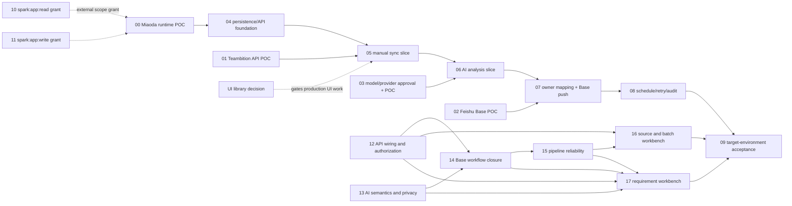

# RQ-Sys MVP — Ticket Drafts

来源：`specs/rq-sys-mvp/`，以当前 PRD revision 60 为产品行为基线。此处是本地待评审 ticket 草案，尚未发布到外部 tracker。

Agent 可直接使用的总任务说明：[`../AGENT-HANDOFF.md`](../AGENT-HANDOFF.md)。

技术栈建议见 [`../../../specs/rq-sys-mvp/TECHNICAL-PLAN-MIAODA.md`](../../../specs/rq-sys-mvp/TECHNICAL-PLAN-MIAODA.md)；首个 POC 需核对 GitHub 仓库与妙搭之间的代码导入/发布方式。

## 建议顺序

先并行验证外部依赖，再按纵向切片开发：

## Ticket list

| ID | Ticket | Status | Depends on |
|---|---|---|---|
| 00 | Miaoda runtime capability POC | partially-available（最新 release `7695421212881750997` 已 finished，绑定 commit `2d901361`；线上页面冷启动与来源读取已复核。Dev 的应用写入/恢复触发器仍未完整验收。） | — |
| 01 | Teambition API and field mapping POC | partially verified（只读按类型计数：需求 311、任务 23、执行用例/日程 0；UI 仍显示 311/314，3 条差异未解释。无任务类型参数时接口默认只返回“任务”类型。字段类型/绑定与差异仍待核实。） | — |
| 02 | Feishu Base schema, upsert, and automation POC | partially verified（本轮官方 Bitable v1 app-token 读取命中合成记录；负责人自动化日志显示仅通知当前用户的步骤成功。该证据仍不等同发布版 Miaoda runtime 的完整 app-mediated E2E；正式表优先级选项仅 P0/P1/P2。） | — |
| 03 | AI provider and data-policy decision/POC | done（2026-10-08 离线校验 5/5 + 超时/无效 key 在线实测 + PII 掩码断言；2026-10-09 有效 key 补跑 T1–T3 全部通过 + 生产适配器冒烟通过并修复 factory env 断链/prompt 样例缺失，证据：specs/rq-sys-mvp/AI-ANALYSIS-POC.md） | D-06 已确认；T1–T3 已验证 |
| 04 | Persisted domain model and server API foundation | implemented-not-target-verified（本地 schema/adapters/API 已覆盖；Miaoda online schema 和 source-config 读路径曾确认，target write/transaction 仍待本次发布后的安全验收） | 00 |
| 05 | Manual Teambition sync vertical slice | implemented-not-target-verified（项目名解析和本地同步流程实现；安全验收使用固定 synthetic fixture，不能抓取正式项目需求） | 00, 01, 04, D-08 |
| 06 | AI analysis vertical slice | implemented-not-target-verified（provider、结构化输出、存储和重试本地实现；Dev 密钥更新后固定合成需求分析及重试成功，但这不是发布版 runtime 的完整目标 E2E） | 03, 05 |
| 07 | Owner mapping and Feishu Base push vertical slice | implemented-not-target-verified（Owner UI/API 和 Base adapter 已有本地回归；需要 dev 指向 POC Base 后执行 app-mediated upsert） | 02, 05 |
| 08 | Weekly schedule, retry, and audit | implemented-not-target-verified（持久 due-job 与受限队列 drain、恢复 handler 已实现；用户选择周一 09:00 Asia/Shanghai。**2026-10-12 目标 runtime 演练通过**：启用 30 分钟 recovery trigger 一个 cron 窗口，`dispatch`/`trigger`/`action` 三阶段均 succeed（`instance_id 17695618791489929242`、`app_env=runtime`、`action` 663ms），应用侧记录 `RQ-Sys scheduled work poll completed`；Dev 计数无变化，触发器已复原为 disabled。同时确认安全性质：周计划关闭时恢复路径不产生工作。**仍未验证**：真正启用周计划后的错窗恢复、durable worker 重启、审计保留。） | 00, 05, 06, 07 |
| 09 | Target-environment end-to-end acceptance | blocked（**2026-10-12 处置完成**：Dev `AI_API_KEY` 已换成有效值（原值 provider 返回 401）并实测 200；误触批次 `020073d7-17ec-4c1f-8521-56a300882b8d` 置为 `failed`、计数校正 30/30、导入行保留；两个租约过期的 sync/analysis 作业置为 `cancelled`，对应 analysis_run 结算为 `failed_retryable`；回读 running 批次/作业/分析均为 0，来源不再被 ActiveBatchConflict 阻塞；30 条真实需求仍停在 `pending_mapping`、未写入 Base；POC Base 删除本人 2 条探针残留（9→7）；online 夹具开关改 `false`；两仓已推送（root `b023600`、app `cd64e8d`）。**当前唯一阻塞：`+release-create` 发布 `cd64e8d` 连续 5 次返回 `code 500000049` 且未返回 release_id**，git 已确认同步、无待发布 schema 差异、本地构建通过，原因未确定；建议由用户在妙搭编辑器发布或携 log_id 找平台支持。仍未验收：发布版 app-mediated E2E、恢复触发器演练、TB 311 vs 311/314 差异、词典与规则内容、P3 冲突。周计划与通知保持关闭。） | 00–08, 12–17 |
| D-08 | Resolve production UI component baseline after repo inspection | resolved（2026-10-08，ADR-001：基线已推送（main，03aef74）并检视——仓库无 UI 依赖，按 design.md 采用 HeroUI v3 + Tailwind；UI 托管方式留待 00） | ADR-001 已产出 |
| 10 | Grant `spark:app:read` user scope for Miaoda apps | resolved（2026-10-09 根因确认：TraeWork 注入凭证遮蔽本地授权；加 `env -u LARKSUITE_CLI_APP_ID -u LARKSUITE_CLI_USER_ACCESS_TOKEN -u LARKSUITE_CLI_BRAND` 后 apps +list/+get/release 与 observability 命令调用成功。member APIs 仍为 feature_not_available；观测数据部分为空/null，详见工单 evidence） | — |
| 11 | Grant `spark:app:write` user scope for Miaoda apps | resolved（2026-10-09 双路径验证：member-add 路径返回 feature_not_available 3340005（该 full_stack app 不支持 CLI 协作者管理，非 scope 问题）；**release-create 路径验证通过**——同一 env -u 前缀下 `+release-create --branch sprint/default --apply-reason` 真实发布成功，release 7694661855108893966 publishing→finished、error_logs 空、无 missing_scope（方案A，用户显式确认；命令 Risk: write 无 --yes 门禁）。spark:app:write 对发布类写操作可用） | — |
| 12 | API wiring, login-only access, and source setup | implemented-not-target-verified（本地实现要求登录、不实现 RQ-Sys app 角色；目标来源写入仍待验证。旧 Dev preview 的 `FORBIDDEN` 与旧客户端文案不能归因为应用角色，需先通过受支持流程发布对齐已测代码，再验证登录用户可创建 schedule-disabled 来源。） | — |
| 13 | AI output semantics, priority rules, and privacy | implemented-not-target-verified（2026-10-09 本地完成：移除证据计数公式，规则 JSON 改为显式 U/M/S/C 评分映射 + 阈值，未发布/未校准规则时 priority 保持 null（buildPriorityRule 返回 null，取值不在映射中不猜测）；maskPii 增补身份证/24 位平台用户 ID/@提及；outbound payload 无姓名/用户 ID/联系方式/凭据的断言测试通过。provider target acceptance remains Ticket 09） | 03 |
| 14 | Complete analysis-to-Base push workflow | implemented-not-target-verified（本地分析终态后推进、失败/低置信度不阻塞推送、快照/映射顺序均有实现；目标 app TLS、身份、Base 凭据/夹具仍未验证） | 02, 12, 13 |
| 15 | Pipeline idempotency, retry, and worker fencing | implemented-not-target-verified（worker fencing/retry 本地验证通过；online Miaoda runtime、durable worker restart、schedule trigger 尚未实测） | 12, 14 |
| 16 | Source settings and batch workbench | implemented（线上 release `7695421212881750997`；冷启动先显示 loading，首屏数据完成后才显示 API 已连接。线上已读回项目名，来源停用、无需求/批次；本地 root/Web 与 Miaoda 测试、typecheck/build 通过。目标 login identity 和 trace-to-release correlation 仍待补。） | 12, 15 |
| 17 | Requirement, owner mapping, retry, and audit workbench | implemented-not-target-verified（本地需求池/详情/重试/审计已接 API；详情现在展示 U/M/S/C 建议、理由、证据和缺证标记；目标身份、飞书通讯录和 Base 权限仍未实测。匹配推送不得等同通知送达） | 12–15 |

`ready-for-agent` 表示可开始做 POC/决策工作，不代表生产集成已具备条件。具体 blocker 在各 ticket 中列出。全生命周期 28 字段不属于这些 tickets。

最新状态（2026-10-11）：Miaoda 应用代码提交 `2d90136` 已推送并发布，release `7695421212881750997` finished。线上冷启动与来源读取通过，线上来源当前停用。Dev 合成分析与 POC Base 读回成功，但浏览器验收误触启动了真实项目同步：Dev 已导入 30 条 TB 记录，批次仍为 running、唯一关联 sync job 租约已过期，无 AI/Base 作业。已请求用户确认取消该批次和作业，保留已导入记录；恢复触发器与每周计划保持关闭。Ticket 09 仍 blocked，直到该批次安全处置、恢复能力验收、311 vs 311/314 差异解释并完成同一环境的安全 E2E。
