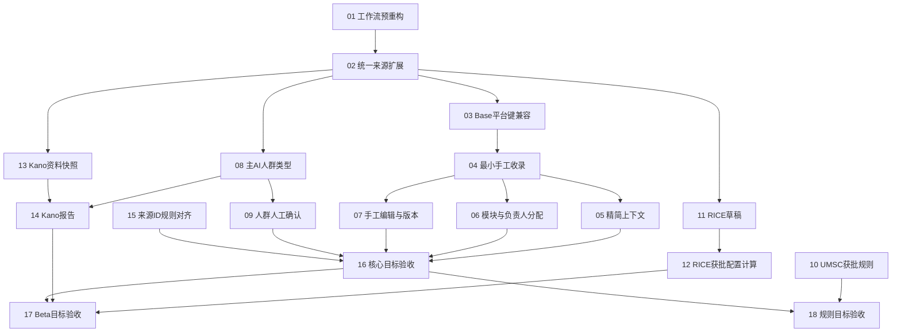

# RQ-Sys V0.2 Spec / Tickets 审阅包

> **已于2026-10-23确认并发布。此目录保留历史审阅稿，不再作为当前任务状态。**
> 当前入口：[正式Spec索引](../../../specs/rq-sys-v0.2/README.md)、[正式Tickets索引](../issues/README.md)。

> 日期：2026-10-22。状态：**draft，待确认测试接缝与任务拆分**。
> 本轮已完成代码/契约静态勘查及拆分草案；没有改业务代码、原PRD、MVP任务状态，也没有运行代码测试、访问生产接口、发布或发送通知。

## 工作流和要解决的问题

TB 同步与 Web 新建需求汇入统一需求记录；保存事实版本后复用主 AI → 负责人 → Base → 通知。无负责人、低置信度、空优先级或首次 AI 失败不阻断合格推送。人工编辑只适用于手工事实。U/M/S/C 是主优先级；RICE/Kano在详情次级Beta入口手动使用。

本包按现有模块化单体做增量扩展，优先复用队列、仓储、AI provider、Base transport、人员选择和审计。结构调整集中在收录/工作流模块及需求功能UI，避免全仓重排。

## 可核对基线

- [V0.2 本地 PRD](../../../docs/2026-10-21-rq-sys-v0.2-prd.md)，SHA256 `cfe2799d2552453c54efa0deb17b466391aef2e7eef5e199207ec47a8e23d762`。它仍标为讨论稿，本文未将其标为正式批准版本。
- 根仓 main：`a3e7b5fa556fd28412ceea3e6a3627e519c139a1`；妙搭 sprint/default：`7d77dcf9a04374ea0b6babfd8dbb5a42d02d5162`。均为本轮本地快照，未检查远端或当前Online发布。
- MVP Spec、领域词汇、OpenAPI、D-11/D-12、UI ADR和本地ticket约定均已读取；较旧运行/验收状态可能过时，不作为本轮目标环境结论。
- 根仓原有未跟踪PRD、资料和图稿保留；妙搭仓勘查时无未提交改动。
- 原MVP PRD与规则仍控制不冲突行为；V0.2正式审批后才按明确增量覆盖。上游/访谈原文引用列于下方，本轮未重新拉取飞书全文或生成真实材料快照。

## Spec 拆分

| ID | 草案 | 负责的问题 |
|---|---|---|
| V02-S00 | [00-unified-requirement-foundation](specs/00-unified-requirement-foundation.md) | 统一需求身份、来源、数据归属及模块职责 |
| V02-S01 | [01-manual-intake-and-edit](specs/01-manual-intake-and-edit.md) | Web新建/编辑、需求级分配 |
| V02-S02 | [02-main-analysis-and-audience](specs/02-main-analysis-and-audience.md) | 主AI、六层人群及U/M/S/C规则 |
| V02-S03 | [03-base-and-notifications](specs/03-base-and-notifications.md) | 平台键迁移、Base投影和通知 |
| V02-S04 | [04-rice-beta](specs/04-rice-beta.md) | 人工RICE草稿、配置与计算 |
| V02-S05 | [05-kano-beta](specs/05-kano-beta.md) | 访谈资料、Kano手动报告与证据 |

## 建议测试接缝（待确认）

1. **主接缝沿用现有受保护的应用HTTP入口**。使用实际仓储和正常worker，在已有外部AI/Base适配位置提供受控实现，检查需求/快照/状态/Base投影/通知事件的外部行为，不新增专供测试的业务端点。
2. 数据库事务、唯一约束、幂等和并发必须另用真实本地PostgreSQL独立schema验证。UI通过现有详情/表单入口测试；无需每拆一个函数就增加mock或逐私有函数测试。
3. **目标验收单独留证**：妙搭公开UI/API → 受控最小模型输入 → 已批准POC Base独立回读 → 批准账号收件。根仓测试通过不代替妙搭、Base或通知验收。

## 任务拆分（编号即依赖标识）

所有草案都是完整可验证的纵向切片；01是必要前置重构，02是兼容模型扩展，16–18是目标整体验证切片。每张开发任务自行包含对应schema/API/UI/测试/双仓对齐，不另设按数据库、API、前端分层的大票。

1. **[收敛共同工作流入口并保持TB行为](tickets/01-workflow-prefactor.md)** — 前置：无代码前置。交付：现有TB需求从拉取到分析、负责人、Base和状态查询继续按原契约工作；后续手工收录可复用同一工作流入口。
2. **[扩展统一来源身份并读回现有TB记录](tickets/02-unified-source-expand.md)** — 前置：01。交付：现有需求可看到来源类型和稳定平台编号，数据结构允许手工来源；所有既有TB记录、版本和关联完整保留。
3. **[按平台编号复用Base旧TB行并安全切换](tickets/03-platform-base-key.md)** — 前置：02。交付：已有TB需求再次推送仍更新原Base行，逐步补平台键；后续无TB ID的需求也能用平台键创建。
4. **[最小新建需求贯通AI与Base](tickets/04-manual-intake-minimal.md)** — 前置：03。交付：用户填写标题、描述、渠道后获得平台编号，并自动进入AI→空负责人Base推送；同请求重试仍为同一条需求。
5. **[补齐精简需求上下文并展示来源](tickets/05-manual-definition-context.md)** — 前置：04。交付：手工需求可选保存产品型号、需求类型、限制、补充说明与来源链接，后续处理只消费批准的上下文。
6. **[需求级选择模块与负责人并通知分配人](tickets/06-direct-owner-and-module.md)** — 前置：04。交付：录入人选择模块及需求负责人，人工分配首推和后续改派通知正确的人，其他需求不受影响。
7. **[手工编辑需求保留版本并安全更新Base](tickets/07-manual-edit-versioning.md)** — 前置：04。交付：用户修改手工需求后重跑必要分析、更新原Base行并保留PM历史；并发及旧任务不覆盖新内容。
8. **[主AI增加需求类型与六层人群建议](tickets/08-analysis-audience-contract.md)** — 前置：02。交付：TB和手工需求均可获得受控模块、U/M/S/C、整体置信度及人群/类型建议；旧分析继续读取。
9. **[PM修改人群并保留人工确认](tickets/09-audience-confirmation.md)** — 前置：08。交付：PM在详情调整L1–L6标签，AI建议、当前人工值和历史分开；重跑不覆盖确认。
10. **[确认并实现版本化U/M/S/C规则](tickets/10-priority-rule-calibration.md)** — 前置：无代码前置。交付：规则定义明确且经历史案例校准后，系统按确定性版本生成P0–P3；确认前继续留空。
11. **[详情Beta入口保存RICE人工草稿](tickets/11-rice-beta-draft.md)** — 前置：02。交付：用户按需打开RICE并保存部分人工输入及依据，默认流程和优先级完全不受影响。
12. **[RICE按获批量纲计算并保留版本](tickets/12-rice-configured-score.md)** — 前置：11。交付：产品组配置周期、单位和映射后，完整人工输入能得到可复算RICE分数及历史。
13. **[Kano选择获批访谈资料版本](tickets/13-kano-evidence-snapshots.md)** — 前置：02。交付：PM在Beta中能查看并选择带来源链接、章节、覆盖限制的安全访谈快照。
14. **[手动Kano生成证据化假设报告](tickets/14-kano-report.md)** — 前置：08、13。交付：用户手动运行Kano，看到成对问题、虚拟倾向、分类假设、引用、置信度与缺口及报告历史。
15. **[对齐同标题不同TB ID的保留规则](tickets/15-source-id-invariant.md)** — 前置：无代码前置。交付：TB不同ID的同标题需求各自保留，同一ID的分页重放只处理一次，手工同标题需求也互不合并。
16. **[核心V0.2兼容迁移与目标验收](tickets/16-core-target-acceptance.md)** — 前置：05、06、07、09、15。交付：在目标妙搭以批准测试数据证明手工建单和既有TB链路均可用，安全完成平台ID/Base键切换并给出发布证据。
17. **[RICE与Kano Beta独立目标验收](tickets/17-beta-target-acceptance.md)** — 前置：12、14、16。交付：Beta功能可单独启用/关闭，RICE可复算、Kano引用和推断边界可核对，主流程始终不受影响。
18. **[获批U/M/S/C规则目标验收](tickets/18-priority-target-acceptance.md)** — 前置：10、16。交付：确认的新规则在目标环境按校准案例正确产生优先级，历史记录及Beta隔离得到证明。

## 依赖与执行顺序

- 核心发布链：01→02→03→04，然后05/06/07与08→09汇合到16。15独立核对当前标题过滤冲突，是核心数据完整性门槛。
- Beta分支：11→12，13与08→14，然后17；Beta没通过可保持关闭，不阻塞核心发布。
- 规则分支：10→18；G-UMSC未确认时继续空优先级，允许核心按现有批准口径交付。
- 图中是代码/功能硬依赖。产品配置、目标授权、材料批准属于独立门槛，不用伪造已完成的代码票替代。
- 经确认后可领取的前沿：01；15需一并确认源ID原则。10可先整理待确认包，但新算法实施等G-UMSC。完成02后08/11/13可与03→04并行；实际并行需避免共改热点契约/仓储。

## 本次需要一并审阅的解释

- **来源ID优先**：不同TB ID同标题各自保留。同标题过滤是当前实现与AGENTS的冲突，15单独纠偏；无自动跨来源合并。
- **Web录入模块与Base PM确认模块分开**：Web能设置录入模块/负责人、人群；Base继续持有PM业务处理与确认。若希望在Web直接修改同一个PM确认模块，需要另批读写归属与冲突规则。本包推荐前者以控制改动。
- **主规则缺失不阻断建单**：U/M/S/C公式、输入含义及阈值确认后才能实施/发布新算法；RICE量纲确认后才正式计算；Kano材料批准后才使用真实材料。这些不阻塞最小新建入口。
- **安全兼容迁移**：先兼容与回填、停止旧writer，再切Base键与开启手工来源；没有将本地已存在编号代码当作线上已部署。

## PRD验收追踪

| V0.2 PRD验收项 | Spec | 任务 |
|---|---|---|
| 1 唯一平台ID/请求幂等 | S00/S01 | 02、04、16 |
| 2 精简必填/定义字段 | S01 | 04、05 |
| 3 两来源同池/状态正确 | S00/S01 | 02、04、16 |
| 4 模块、负责人、首推通知 | S01/S03 | 06、16 |
| 5 平台键Base幂等/TB可空 | S00/S03 | 03、04、16 |
| 6 编辑、快照、同一行、待处理 | S01/S03 | 07、16 |
| 7 主AI与优先级 | S02 | 08、10、18 |
| 8 Beta隐藏/手动/隔离 | S04/S05 | 11、14、17 |
| 9 RICE人工输入与待补充 | S04 | 11、12、17 |
| 10 Kano带证据假设 | S05 | 13、14、17 |
| 11 人群人工值与AI分离 | S02 | 09、16 |
| 12 规则校准及版本确定性 | S02 | 10、18 |
| 最新D-12通知与PM保护 | S03 | 06、07、16 |
| AGENTS来源ID不变量 | S00 | 15、16 |

## 发布这些文档的下一步

`to-spec`要求先确认测试接缝；`to-tickets`要求先确认颗粒度与阻塞关系。本包是供确认的完整草案，不是已批准可领取任务。

确认后：将6份Spec发布至 `specs/rq-sys-v0.2/`，18张票发布至新的 `.scratch/rq-sys-v0.2/issues/`，补充tracker版本目录约定与索引；按技能赋予ready-for-agent，同时保留真实代码依赖、产品门槛和目标验收门槛。旧MVP票不关闭、不重编号。此次确认不等于授权开发或目标环境发布。

补充阅读：[代码勘查与结构方案](CODEBASE-ASSESSMENT.md)、[字段归属表](FIELD-OWNERSHIP.md)、[契约与状态方案](CONTRACT-AND-STATES.md)、[产品与发布门槛](DECISIONS-AND-GATES.md)。

## 来源引用

- MVP PRD（既有基线）：https://aimagene.feishu.cn/wiki/Ybftwjz6KiczNskNR0ec0oCinRc
- 技术设计（既有基线）：https://aimagene.feishu.cn/wiki/RWzlw1yQDiHvnLk9k1kchOimndh
- 需求处理流程：https://aimagene.feishu.cn/wiki/JEyLwBYOziz0bPknDSgcjhuTn9g
- 六层人群：https://aimagene.feishu.cn/wiki/F3Rkwm32OifrYlkIXe2cT8JQntf
- 访谈总结：https://aimagene.feishu.cn/wiki/Qp5Xwo5U6iDpRckjjFecYy9FnPe
