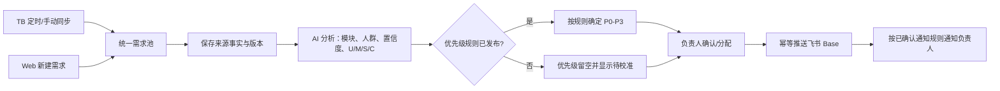

# RQ-Sys V0.2 PRD 增补：多来源需求收集、可选 Beta 分析与重复需求处理

> **文档类型**：增量 PRD（产品需求文档）<br>
> **版本**：V0.2 修订稿（2026-10-29：重复处理、加载与刷新体验增补）<br>
> **日期**：2026-10-22，2026-10-27、2026-10-28、2026-10-29 修订<br>
> **适用范围**：在现有 TB→RQ-Sys→飞书 Base MVP 基础上，增加 Web 新建需求入口，并为后续多来源接入建立统一需求记录；U/M/S/C 是默认分析和优先级主流程，RICE 与 Kano 作为按需打开的 Beta 工具。现有 TB 同步、模块分类、负责人映射、Base 推送和通知行为继续适用。
> **证据边界**：Kano 初始内容是对现有访谈总结的 AI 桌面推演，不是真实受访者作答或标准 Kano 调研结果。

> **【本次更新 · 2026-10-22】**增加 Web 新建需求与跨来源统一记录；确认 U/M/S/C 是默认优先级主流程，RICE/Kano 为手动触发的次级 Beta 功能；按当前代码结构补充工作项和工作量评估。

> **【增补 · 2026-10-24】**收录 2026-10-24 全量代码审查产出的 12 项工程加固项（见 8.5）。逐项核对后确认均不与 V0.2 范围、验收标准或 MVP 不变量冲突；属工程与质量债，不改变本 PRD 的产品范围与验收标准。同轮审查发现的 28 项缺陷已在两仓工作树修复并全绿（详见当轮审查记录），不在本表重复。

> **【本次更新 · 2026-10-27】**确认 U/M/S/C 评分 v2：AI 直接给出九项输入分数和 α，必须同时给出评分依据、假设标记和说明；PM 可修改任一单项分数和 α，由服务端按固定公式重新计算综合分与 P0–P3。旧的“高/中/低求和”规则保留为历史兼容，不静默回算历史结果。配套 Spec 为 `specs/rq-sys-v0.2/06-ai-scoring-and-priority.md`，实施票为 V02-T19–T22。<br>
> **【本次更新 · 2026-10-28】**详情信息架构调整：摘要卡突出综合评分与优先级，返回按钮置于卡片顶部；评分与 AI 分析整合为一个“AI 评分与优先级”区域，U/M/S/C 四维均显示评分及其 AI 依据；人群 AI 建议在未确认时默认选中首个建议，PM 可修改后显式保存，并区分 AI 建议、PM 选择和保存按钮的视觉层级。验收标准补充第 18–21 项。

> **【本次更新 · 2026-10-29】**新增两块产品要求：**重复需求处理**（§4.7）与**加载与刷新体验**（§4.8）。
> 重复/忽略判定改为独立于需求记录的持久决策，应用内删除记录或 TB 全量/增量重同步后仍生效，并压制 AI 分析、Base 推送与通知；Web 增加处理状态筛选、详情确认/撤销动作。加载体验要求首屏骨架屏、进行中操作只做局部/静默刷新，避免整页闪烁。验收标准补充第 23–29 项。同日完成一批工程加固与缺陷修复（见 §8.6），不改变既有产品范围；重复处理的指纹兜底、Base 重复行标记与内容变化复核列为后续（§6）。

## 1. 背景与目标

现有 MVP 以单一 Teambition 项目为入口，需求事实结构和推送键也围绕 TB 字段设计。实际需求还会来自售后、销售、运营、用户反馈及产品内部等多个渠道。V0.2 首先增加 Web 手动新建需求，让这些尚未进入 TB 的需求也能进入同一需求池，并复用已有的 AI 分析、负责人分配、Base 推送与飞书通知。

V0.2 目标：

1. 支持记录 TB 同步及 Web 手动新建两种来源；来源渠道作为业务属性记录，后续外部系统接入按独立连接器迭代，不要求本期接入所有渠道。
2. 新建需求只收集定义和流转所需的精简字段，使用系统生成的 RQ-Sys 需求平台 ID，并进入现有 AI→负责人→Base→通知链路。
3. 默认分析仍以 U/M/S/C 为主，并通过经校准、版本化的规则生成 P0–P3；RICE 和 Kano 不参与默认优先级。
4. RICE 与 Kano 放在需求详情的次级 Beta 入口中，由用户按需触发。Beta 结果不阻断创建、分析或推送，也不覆盖 U/M/S/C 与 PM 确认值。

## 2. 目标用户与对象

### 2.1 使用角色

- **需求提出人 / 录入人**：在 Web 新建需求；默认由当前登录账号记录为录入人，可提供来源渠道和必要上下文。
- **PM / 产品组成员**：查看 U/M/S/C 与模块建议，确认或修改适用人群、模块和负责人；需要时打开 Beta 工具。
- **需求负责人**：在 Beta 中手动填写并确认 RICE 输入；不填写也不影响主流程。
- **系统**：保存来源、需求版本、AI 分析、负责人和推送记录；跨来源使用同一需求详情和后续流转能力。

### 2.2 用户人群字典

需求可关联一个或多个六层人群标签：

| 层级 | 名称 | 英文名 | 使用说明 |
|---|---|---|---|
| L1 | 职业级 | Pro | 职业车手及以骑行为职业的人群 |
| L2 | 竞技级 | Racing | 参加竞技、追求成绩和训练表现的人群 |
| L3 | 爱好者 / 专业入门 | Enthusiast | 有规律骑行并向系统训练或竞技进阶的人群 |
| L4 | 健身锻炼 | Fitness | 以健身、运动和健康管理为主要目的的人群 |
| L5 | 休闲娱乐 | Recreation | 以骑游、亲子、旅行和休闲体验为主要目的的人群 |
| L6 | 通勤代步 | Commuter | 以日常通勤或代步为主要目的的人群 |

人群标签描述需求适用的目标人群，不作为用户个人档案或用户身份识别。地区、国家和产品线等维度可作为独立上下文，不并入六层标签。

## 3. 用户流程

### 3.1 默认需求处理主流程



1. TB 需求继续按 MVP 流程同步；Web 新建需求由录入人提交。两种来源使用同一需求详情和后续 AI、负责人、Base 推送流程。
2. AI 对来源文本给出受控功能模块、整体置信度、适用人群建议和 U/M/S/C 维度建议；理由、证据和缺失信息分开展示。
3. P0–P3 只从已发布的 U/M/S/C 规则确定性计算。规则未发布时保持空值，Beta RICE/Kano 不代替、不补算优先级。
4. 负责人可由模块责任人作为候选建议，最终由录入人/PM 确认或在详情中人工选择；未分配负责人仍允许推送。
5. Base 按需求平台 ID 更新同一条记录；负责人通知沿用当前已确认的 MVP 通知策略。新建需求人工指定负责人后首次推送，应通知该负责人；未分配负责人仍可推送且不向虚构收件人发消息。

### 3.2 新建需求流程

1. 用户在需求池点击“新建需求”，填写标题、需求描述、来源渠道；产品/型号、需求类型、边界限制和补充说明按实际情况填写。
2. 需求描述提供“用户/场景—现状问题—期望结果”的填写提示。标题和描述是提交必填项；四段内容不完整时可以保存并继续流转，由 AI 标出缺失项，不因信息不完整阻断推送。
3. 系统记录当前登录人为录入人，生成连续且不可变的 RQ-Sys 需求平台 ID，保存第一个来源快照并排入主 AI 分析。
4. 用户可以在创建时选择功能模块和负责人；若模块已绑定负责人，可预填为候选，但不静默替用户作出分配。负责人字段可以留空。
5. AI 首次尝试结束后，按现有规则进入负责人匹配与 Base 推送；低置信度、缺失维度、AI 失败均不阻断可推送需求。
6. 后续编辑需求定义字段时，保存新版本、重跑主 AI 分析，并更新同一条 Base 记录；在更新前先按现有规则快照 PM 字段，更新后将 PM 状态置为“待处理”。

### 3.3 可选 Beta 流程

Beta 不参与定时分析或同步后的自动分析。用户在需求详情的“更多 / Beta 分析”入口手动启动 RICE 或 Kano；每次结果独立保存、可追溯，关闭 Beta 面板不影响主需求流转。

## 4. 功能需求

### 4.1 新建需求与来源

#### 新建需求字段

| 字段 | 必填 | 来源 / 处理规则 |
|---|---|---|
| 需求平台 ID | 系统生成 | `RQ-000001` 连续编号；不可编辑；作为 RQ-Sys 与 Base 的统一记录键。 |
| 需求简称 / 标题 | 是 | 简洁描述用户问题或诉求；不强制将方案名当标题。 |
| 需求描述 | 是 | 提供用户、场景、现状问题、期望结果提示；缺失段落由 AI 标记，不阻断提交或推送。 |
| 来源渠道 | 是 | 选择需求处理流程定义的渠道类别，如销售、售后、电商、运营/用研、终端用户、产品/研发/测试等；首期选项固定配置，不新增渠道管理后台。 |
| 来源类型 | 系统生成 | `teambition` 或 `web_manual`。TB 字段仅 TB 来源适用；来源类型与业务来源渠道分开。 |
| 录入人 / 创建时间 | 系统生成 | 来自可信登录上下文和服务端时间；不要求填写手机号或联系方式。 |
| 关联产品/型号 | 否 | 需求涉及的产品型号；仅保存录入人明确提供或来源明确返回的内容。 |
| 需求类型 | 否 | 新增功能、功能扩展、体验优化、性能优化、质量修复、安全合规、成本效率、技术治理；可人工选择，AI 可给建议。 |
| 边界/限制 | 否 | 兼容性、法规、成本、上市时间等已知约束；未知留空，不由 AI 编造。 |
| 补充描述 / 来源链接 | 否 | 录入人可补充背景或原始来源链接；附件文件不进入 MVP AI 输入。 |
| 适用人群 | 否 | L1–L6 的 AI 多选建议及 PM 可编辑值；属于轻量上下文，不作为优先级、创建或推送门槛。 |
| 功能模块 / 负责人 | 否 | AI 建议受控功能模块；模块关联人员可作为候选，用户确认/更改负责人。未分配仍可推送。 |

姓名、手机号、邮箱和用户 ID 不作为模型输入。录入人身份由系统审计记录，不把登录身份直接拼进 AI 提示词。

#### 统一来源与数据归属

- V0.2 本期新增的非 TB 入口仅为 `web_manual`。渠道字段可描述需求来自售后、销售等场景，但不表示已连接这些外部系统或自动采集数据。
- Teambition 来源事实仍由 TB 持有；Web 手动创建的需求事实由 RQ-Sys 数据库持有。飞书 Base 是统一 PM 协作和通知投影，不反向成为两类需求的原始来源。
- RQ-Sys 数据库 ID / 需求平台 ID 是统一记录身份；TB 需求 ID、项目 ID 和 TB 地址作为 TB 来源专属的可空字段保留。Base 按需求平台 ID 幂等创建/更新，TB ID 仅用于来源追溯，不能要求手工需求提供 TB ID。
- Web 新建与编辑必须使用请求幂等键、审计记录和追加式来源版本。重复提交不应产生第二个需求平台 ID 或第二条 Base 记录。
- Base 字段只投影需求定义、来源追溯、AI 主流程结果、负责人和 PM 协作字段。不得把完整 28 字段一次性复制到 Base。

#### 主流程状态

| 场景 | 来源状态展示 | 后续状态 |
|---|---|---|
| TB 导入 | 已同步 / 同步失败 | AI 分析、负责人、Base 推送分别展示 |
| Web 新建 | 已收录 / 创建失败 | AI 分析、负责人、Base 推送分别展示 |

Web 新建不能伪装成 TB“已同步”。未发布 U/M/S/C 规则时优先级显示“待校准”，而不是分析失败。

### 4.2 U/M/S/C 主评分与优先级

> 实现级契约、API、数据模型与票拆分见 [V02-S06](../specs/rq-sys-v0.2/06-ai-scoring-and-priority.md)；本节的公式、阈值和 α 口径是产品决策。

#### 4.2.1 目标与原则

- U/M/S/C 是默认、唯一影响主流程 P0–P3 的价值评估框架。
- **AI 直接评分**：AI 对九个评分输入项分别给出 1–5 或 1–3 的分数，并给出 α、依据、假设标记和说明；不再只给“高/中/低”。
- **服务端确定性计算**：正式综合分和 P0–P3 由服务端按已发布的评分 v2 规则计算，不采用模型自报的最终优先级。AI 可以在说明中给出试算综合分，但落库和展示以服务端结果为准。
- **人工可修订**：PM 可修改任一单项分数和 α，服务端立即按同一公式重算；不提供直接修改最终 P 或公式/阈值的入口。
- 评分明细、AI 建议、人工当前值和历史分别保存；人工修改不自动触发 Base 推送或通知。
- Kano 不在本期评分公式内；没有合格样本时保持“未评”，不伪造比例或样本量。RICE 仍是独立 Beta，不参与 U/M/S/C 或 P0–P3。

#### 4.2.2 评分输入

| 维度 | 输入项 | 取值范围 | 含义 |
|---|---|---|---|
| U 用户价值 | `pain` 痛点强度 | 1–5 | 1 几乎无感；3 明显不便；4 阻碍目标；5 涉及安全/不可逆后果 |
| U 用户价值 | `frequency` 发生频次 | 1–5 | 1 极少；3 每月；5 几乎每次骑行/每天 |
| M 市场价值 | `sellingPoint` 卖点强度 | 1–3 | 1 无对外卖点；2 可作对比支撑；3 核心差异化卖点 |
| M 市场价值 | `competitor` 竞品差异 | 1–3 | 1 未核实/无差异；2 与竞品持平；3 明显领先 |
| S 战略价值 | `roadmap` Roadmap 匹配 | 1–3 | 1 未规划/无证据；2 已列入候选或中期；3 当前版本/战略重点 |
| S 战略价值 | `dependency` 战略依赖/杠杆 | 1–3 | 1 独立单点；2 依赖现有平台但可复用；3 关键战略能力或跨产品协同 |
| C 成本 | `workload` 工作量 | 1–5 | 1 很小；5 很大 |
| C 成本 | `technicalRisk` 技术风险 | 1–5 | 1 很低；5 很高 |
| C 成本 | `resource` 资源占用 | 1–5 | 1 很低；5 很高 |
| α 修正系数 | `alpha` | 0.5–2.0，步长 0.1 | 证据强度/安全修正；默认见 4.2.3 |

所有输入项均为整数（α 为一位小数）。缺证据不是空值：AI 必须给出点估计，并标记 `assumption=true`、写明假设依据；置信度不足不得伪造成原文事实。

#### 4.2.3 计算规则

```text
U = pain × frequency                 （1–25）
M = sellingPoint × competitor        （1–9）
S = roadmap × dependency             （1–9）
C = MAX(workload, technicalRisk, resource)   （1–5）
U_adj = U × α
综合分 = round2( U_adj × (1 + 0.6 × M + 0.4 × S) ÷ C )
```

α 默认值：

| 场景 | 默认 α | 说明 |
|---|---:|---|
| 单条反馈/单渠道/无交叉证据 | 0.8 | 防止单点反馈被当作总体结论 |
| 多渠道或多条独立反馈 | 1.0 | 仍需在依据中说明来源数量与渠道 |
| 已确认涉及安全/不可逆后果 | 1.5 | 同时设置安全复核标记；不自动改 P，必须人工复核 |

PM 可在 0.5–2.0 范围内修改 α，并填写理由。α 不是“拍脑袋加分项”，修改必须记录在版本历史中。

P0–P3 阈值（本期唯一口径，不再使用其他阈值表）：

| 综合分 | 优先级 |
|---:|---|
| ≥ 45 | P0 |
| 25–44.99 | P1 |
| 10–24.99 | P2 |
| < 10 | P3 |

计算示例（历史试评，用于校准和回归）：

| 需求 | U（痛点×频次，α） | M | S | C | 综合分 | P |
|---|---|---|---|---:|---:|---:|---|
| 车灯模式选择 | 3×4，α=0.8 | 1 | 1 | 3 | 6.40 | P3 |
| Di2 换挡警示 | 4×4，α=0.8 | 1 | 1 | 3 | 8.53 | P3 |
| Di2（确认涉安全） | 4×4，α=1.5 | 1 | 1 | 3 | 16.00 | P2，转安全复核 |
| C706×GX 适配 | 4×5，α=0.8 | 4 | 1 | 4 | 15.20 | P2 |
| 媒体控制 | 4×4，α=0.8 | 4 | 1 | 4 | 12.16 | P2 |
| 传感器重命名 | 3×2，α=0.8 | 1 | 1 | 3 | 3.20 | P3 |

边界规则：C 最小值 1，因此不会除零；输入越界、非整数、非有限数或规则不完整时，不生成正式分和 P，保留上一次有效评分并提示修正。综合分按四舍五入保留两位小数；阈值按四舍五入后的分数判断。

#### 4.2.4 AI 直接评分与依据

AI 分析结果新增评分对象，必须同时包含：

- 九个输入项的整数分数、α 和每个输入项的依据；
- 每项依据：引用的原文证据，或 `assumption=true` 加明确的估算假设；
- 一段总体评分说明，解释为什么这些分数和 α 合理；
- 风险/安全标记及依据（若有）；
- 评分置信度（高/中/低）和理由。

硬性约束：

- 评分依据只能引用本次分析输入中的原文片段；不得编造竞品、Roadmap、研发工作量或用户频次事实。
- 没有证据时允许点估计，但必须标记假设；假设不得写成“已验证事实”。
- 输入越界、缺少依据/假设说明、证据不在原文中、α 不在范围内，均拒绝整条评分输出并进入可重试失败；不生成伪精确分。
- 模型不能直接写最终 P0–P3；服务端按公式计算。模型自报的优先级字段被忽略/拒绝。
- AI 评分失败不阻断需求创建、同步、负责人或 Base 推送；详情显示“评分待重试”，PM 可手动补齐。

#### 4.2.5 PM 修改单项评分和 α

详情页提供评分编辑：

1. PM 可修改任一输入项分数和 α；不能修改公式、阈值或综合分/P 本身。保存时服务端重算综合分与 P。
2. 每次保存必须填写修改理由；记录操作者、时间、修改前后值、版本号、评分置信度和 AI 原始建议。
3. 保存使用版本号做乐观并发控制；版本冲突返回 409，并在界面提示刷新后重试。
4. AI 评分与人工当前值分开保存。人工值不会被下一次 AI 重跑静默覆盖；详情同时展示“AI 建议”和“当前评分”。
5. 用户可选择“采用 AI 建议”：以 AI 最新建议的九项输入和 α 生成一个确认版本，记录操作者/理由；之后 PM 仍可继续修改。
6. 人工修改评分不自动重推 Base、不重置 PM 状态、不发通知、不启动 Kano/RICE。
7. 允许任何已登录的租户用户修改（V0.2 不引入 RBAC 角色矩阵）；所有操作以服务端可信身份记审计。

#### 4.2.6 评分版本与 AI 重跑

- 评分版本状态：`ai_suggested`（AI 新建议）、`current`（当前生效）、`confirmed`（人工确认）、`superseded`（历史）。同一需求只有一个当前生效版本。
- 分析或需求编辑触发 AI 重跑时，新建 AI 建议版本：
  - 当前没有有效评分：AI 建议自动成为当前；
  - 当前已有 AI/人工确认评分：不覆盖当前，详情展示新建议并提供“采用 AI 建议”；
  - 人工修改过的评分始终保留为当前，直到用户明确采用新 AI 建议或再次保存。
- 每个评分版本固定：需求来源版本、分析版本、评分规则版本、AI 提示词/模型版本（AI 建议时）、操作者/时间和完整输入快照。
- 历史版本只读；已发布规则不静默回算旧评分。旧版 v1 高/中/低求和规则生成的优先级继续按原分析版本展示，不因 v2 发布而改变。

#### 4.2.7 UI 与数据展示

**信息架构**

详情页顶部是需求摘要卡，之后是一个整合的“AI 评分与优先级”区域；不再把评分和 AI 分析拆成两个并列区块。

- **摘要卡**：最顶部是“返回需求池”，其下依次是标题/平台 ID、评分与优先级主视觉、负责人和流程状态、操作按钮。评分主视觉显示当前有效综合分（保留两位小数）、P0–P3 和评分置信度；没有评分时显示“暂无评分 / 评分待生成”，不伪造 0 分或 P。
  - 摘要卡只读取当前有效评分（`current`）；若只有 AI 新建议而没有当前值，显示“AI 建议 15.20 · P2”，点击进入评分区查看/采用，不把建议写成正式当前分。
  - 返回按钮在卡片最顶部，不放在标题右侧或内容区中部；移动端同样保持首屏可见。
- **AI 评分与优先级区域**：标题下首先是综合分/P 主视觉和评分版本状态，然后是 U/M/S/C 四维评分卡、九项输入表和 AI 分析建议；完整的 AI 说明、证据、假设和缺失信息作为该区域的次级内容展示。
  - U/M/S/C 四张维度卡分别显示该维度的合成值（U = 痛点×频次；M = 卖点×竞品；S = Roadmap×依赖；C = 三项成本最大值）、对综合分的贡献/含义，以及 AI 对该维度的建议、理由、证据或“需要补充”标记。
  - 九项输入表显示 AI 建议值、当前值、每项依据/假设；PM 编辑、保存、取消、采用 AI 建议和历史入口均在此区域内。
  - 模块、类型、适用人群和整体置信度作为“其他 AI 建议”展示；不得再出现第二个独立的“AI 分析与建议”大区块，避免同一分析内容重复出现。
  - 无评分/旧分析时，仍显示现有 AI 定性建议，并在评分位置提供“手动填写评分/重新分析”入口；规则未发布或评分失败时显示明确状态，不阻断详情其他部分。
- **适用人群**：放在 AI 评分与优先级区域内，靠近 AI 人群建议；AI 建议和 PM 当前标签分开显示。未确认时默认选中首个 AI 建议（见 §4.4），PM 修改后点击“保存人群标签”才生效。Beta 分析入口保留为次级入口，不抢占评分主视觉。

**评分区核心布局骨架**

```text
┌──────────────────────────────────────────────────────────┐
│ ← 返回需求池                                              │
│ 需求标题...                              ┌──────────────┐  │
│ RQ-000342 · v1                          │ 综合评分 15.20│  │
│                                         │ P2 · 中置信度 │  │
│ 负责人 ...    [已同步][已分析]...       └──────────────┘  │
│ [分配/变更负责人] [重新分析] [刷新]                        │
├──────────────────────────────────────────────────────────┤
│ AI 评分与优先级                    [编辑评分] [历史] [采用AI]│
│ 当前 v3 · P2 · 中置信度 · 综合分 15.20 · 公式摘要（只读）   │
├──────────────────────────────────────────────────────────┤
│ U 用户价值 16   M 市场价值 4   S 战略价值 2   C 成本 3     │
│ （每张卡附 AI 建议、理由、证据/假设）                       │
├──────────────────────────────────────────────────────────┤
│ 九项输入：AI建议 / 当前值 / 依据或假设 / 是否假设           │
│ α 修正系数 ...                                             │
├──────────────────────────────────────────────────────────┤
│ 其他 AI 建议：模块 / 类型 / 适用人群 / 整体置信度           │
│ 依据、假设、缺失信息（次级、可折叠）                        │
└──────────────────────────────────────────────────────────┘
```

**验收与交互要求**

- 摘要卡必须在首屏显示综合分和 P；无评分时显示空状态，不得用旧版分析的自报 P 冒充当前评分。
- U/M/S/C 四维、九项输入、综合分和 P 的数值必须来自服务端当前评分版本；公式只读。
- 评分与 AI 建议只保留一个区域标题；移动端维度卡纵向排列，九项输入表可横向滚动。
- 评分编辑保存后摘要卡和评分区同时刷新；若版本冲突，摘要卡保留旧值并提示刷新，不显示未确认的新分。
- 所有空/失败/规则未发布状态沿用 §4.2.8；视觉上评分是主信息，AI 其他建议和证据是辅助信息。

#### 4.2.8 安全、异常与边界

- **安全标记**：AI 可基于原文标记安全相关；PM 可在评分编辑中修正并填写理由。安全标记只触发“安全复核”提示，不自动把 P 改为 P0，也不绕过公式；复核人应确认是否提高单项分数/α 或转人工决策。
- **缺失/假设**：某项无证据时仍可评分，但必须有假设说明和低置信度标记；若 AI 无法生成合法评分对象，整条评分进入可重试失败，主流程继续。
- **规则未发布**：沿用既有规则未发布语义，优先级留空并显示“待校准”；不得用 RICE/Kano 或模型自报 P 填充。
- **并发**：同一评分版本并发保存只能有一个成功；冲突必须提示并保留用户输入。
- **不可用**：AI 超时/限流/非法输出、数据库版本冲突、规则缺失都不能导致主需求详情不可打开；降级展示上一有效评分或“评分待重试”。

#### 4.2.9 与 Beta 分析的关系

- Kano 仍只在 Beta 手动运行，输出定性假设；没有合格样本时显示“未评”，不进入综合分。
- RICE 仍只在 Beta 手动保存草稿/计算，不参与 U/M/S/C、综合分或 P0–P3。
- Beta 结果不能覆盖评分当前值，也不能触发主评分重算或 Base 推送。

### 4.3 RICE 手动评分（Beta）

RICE 位于需求详情的次级“Beta 分析”入口，仅在用户主动打开并填写时运行。它不出现在默认需求池主流程，不自动触发，也不用于 U/M/S/C 或 P0–P3 计算。需求负责人负责录入并确认四项输入，AI 不自动填写或覆盖人工最终值：

| 字段 | 含义 | 输入责任 | 约束 |
|---|---|---|---|
| Reach | 在约定周期内受影响的用户数或事件数 | 需求负责人 | 周期和计量单位需在产品组统一配置；允许填写依据说明 |
| Impact | 对单个受影响用户或既定目标的影响程度 | 需求负责人 | 使用产品组配置的离散等级和对应分值 |
| Confidence | 对 Reach、Impact、Effort 估算的把握程度 | 需求负责人 | 使用产品组配置的百分比或离散档位，并填写依据 |
| Effort | 完成需求所需的整体投入 | 需求负责人 | 使用产品组统一的人月/人周/人日单位；范围可包含相关产品、设计、研发与测试投入 |

**计算规则**：`RICE = Reach × Impact × Confidence ÷ Effort`。Confidence 若以百分比输入，计算时转换为 0–1。Effort 必须大于 0；任一字段缺失、无效或 Effort 为 0 时，不计算分数，展示“待补充”。

**人工责任与历史**：记录录入人、最后修改人、时间和字段变更前后值。AI 可提示缺项、解释公式或协助整理估算依据；不得将 AI 推算值写成负责人已确认的 RICE 输入。

**待产品组配置**：Impact 档位及映射分值、Confidence 档位/百分比、Reach 周期与单位、Effort 单位。配置确定前，Beta 仅可保存草稿输入，不展示跨需求正式排名。该配置不影响主流程优先级。

### 4.4 六层用户人群建议与人工修改

- AI 对每条需求输出 0 个或多个建议层级，并为每个建议附理由和证据；该标签作为主流程的非阻断上下文，不等于 Kano 结论。不得因材料中“未提到”就推断该人群不适用。
- **默认选择**：当 PM 尚未确认人群（`confirmed=false`）、且 AI 至少给出一个层级时，UI 默认选中 AI 输出顺序中的第一个建议层级，作为未保存的编辑草稿；不自动写入 PM 确认值，也不把 AI 建议伪装成人工结论。AI 有多个建议时用户可继续多选；AI 没有建议时不默认选择。若 PM 已确认过（包括确认空集），刷新详情不得恢复默认选择或覆盖 PM 当前值。
- PM 可以在需求详情中添加、取消或替换 L1–L6 标签，允许多个层级并存；修改后必须点击“保存人群标签”才生效，保存不触发分析、推送或通知。
- 视觉区分：AI 建议使用带“AI 建议”标识的浅色/虚线建议标签；PM 可点击的标签使用独立的选择样式（选中态与未选中态明确）；“保存人群标签”是独立的主按钮，不能与标签采用同一外观。AI 建议、PM 未保存选择、PM 已确认值三者不得混淆。
- 同时保存 AI 建议和 PM 当前标签，人工修改不得覆盖或伪装成 AI 结果。
- 若证据不足，显示“待判断”，并指出需要补充的人群信息。
- 人群修改记录操作者、时间及变更前后值。

### 4.5 Kano AI 假设（Beta）

Kano 仅由用户在 Beta 入口手动触发，不作为同步后的自动分析步骤，不产生或调整 P0–P3，也不阻断需求推送。首期输出仅为基于访谈总结和当前需求的定性研究假设。

#### 输入

- 当前需求的标题、描述及批准进入 AI 的非个人业务上下文。
- 当前需求的人群标签及其确认状态。
- 已批准的、去标识化的访谈总结及来源章节/链接。

姓名、手机号、邮箱、用户 ID、未批准的原始个人信息和附件原文不得发送给模型。访谈总结若包含可识别个人信息，应先清理或遮蔽。

#### 问卷模板

对每个需求能力点，按目标人群分别生成一组 Kano 成对问题：

1. **功能正向题**：“如果产品具备【能力】，且体验达到【可理解的质量描述】，你的感受是？”
2. **功能反向题**：“如果产品不具备【能力】（或无法提供该体验），你的感受是？”

每题选项：喜欢、理所当然、无所谓、可以接受、不喜欢。问题需使用具体能力和场景，避免把多个功能合并成一个宽泛问题。

本轮允许 AI 基于访谈总结推演虚拟画像的可能回答倾向，用于形成研究假设；推演结果不得生成虚构的受访者记录、样本数、百分比、显著性或 Kano 系数。

#### 输出

| 字段 | 说明 |
|---|---|
| Kano 候选类型 | 基本型、期望型、一维质量、魅力型、无差异型、反向型、证据不足；术语可由产品组统一 |
| 适用人群 | 一个或多个 L1–L6；证据不足时为待判断 |
| 解释 | 说明能力存在/缺失对该人群满意度的推测影响 |
| 证据 | 访谈总结中的摘要事实或原文片段，并附文档链接和章节/主题 |
| 置信度 | 高/中/低的定性判断，解释证据覆盖和不确定性；不是统计置信区间 |
| 研究状态 | AI 假设（待验证）/ PM 已复核 / 已有真实 Kano 问卷验证 |
| 缺口 | 未覆盖人群、冲突证据、缺失样本或需要进一步询问的问题 |

访谈推演始终标记“AI 假设（待验证）”。真实问卷数据只有在采集实际配对回答后，才可进入统计归类；不得用虚拟回答替代真实回答。

### 4.6 访谈材料与证据管理（Beta）

- 访谈总结作为可版本化的 AI 参考材料，至少包含人群/产品线（已知时）、场景、需求或痛点、访谈时间（已知时）和来源链接。
- 不要求来源总结提供无法确认的字段；缺失字段明确标为未知。
- 分析结果引用具体来源材料和主题，支持 PM 回到原文核对。
- 更新访谈材料或需求内容后，新的 AI 分析生成新版本；历史分析保留，不静默覆盖。

### 4.6 总览页优先级分级统计

- 总览页新增“优先级分级”区域，显示 P0、P1、P2、P3 的需求数量，以及“待评分”数量；统计口径为全量业务需求，合成验收数据不计入。
- 分级取数优先级：
  1. 当前有效评分版本（`current/confirmed`）的 P0–P3；
  2. 没有评分、但最近一次已分析版本有历史优先级的，使用该历史优先级，并在界面标注“历史分析优先级（v1）”，不套用 v2 分数范围；
  3. 两者都没有的计入“待评分”，不得用 0 分或模型自报 P 补齐。
- 区域需展示当前已发布评分规则及范围：P0 ≥45、P1 25–44.99、P2 10–24.99、P3 <10；规则未发布时明确提示，不用其他规则替代。分数以服务端评分版本为准。
- 统计区应同时显示已分级/待评分数量和“其中历史优先级 X 条”，让用户理解为什么分级数量总和与总需求数可能不同；点击“查看需求池”进入需求池。
- 该统计只读，不改变任何需求状态或优先级；刷新总览时随指标 API 更新。


### 4.7 重复需求处理（P1，2026-10-29 新增）

#### 4.7.1 目标与原则

- **目标：避免重复处理。** 同一问题被多次提交、或历史需求被重复导入时，不应重复执行 AI 分析、负责人分配、Base 推送和飞书通知。
- **判定与记录生命周期解耦。** 判定按来源稳定身份持久保存，不依赖应用内需求行是否存在；删除应用记录或 TB 重推不能使已确认的判定失效。
- **只有人工确认才压制。** 系统提示的“疑似重复”只做提示，不隐藏、不压制；压制必须由 PM Leader / 指定操作人显式确认，且可撤销。
- **单一事实源。** 需求是否被压制统一由决策派生，同步与分析/推送链路都读取同一状态，不允许各处理分支各自推断。

#### 4.7.2 判定对象与身份

- P1 覆盖 **TB 来源**需求：决策以 `(来源配置 ID, TB 需求 ID)` 为稳定键保存，应用内删除记录、TB 全量或增量重同步、记录重新导入后，同一 TB 需求再次出现时自动继承已确认判定。
- `web_manual` 来源在本轮不落决策（无 TB 需求 ID）；后续版本再定义手工需求的稳定身份。
- 同标题提示仍可自动刷新（仅提示），但**不得覆盖人工确认的判定**。

#### 4.7.3 判定动作

PM Leader / 指定操作人可在需求详情执行：

| 动作 | 语义 | 处理结果 |
|---|---|---|
| 确认重复 | 指定一条主记录（canonical），本条为副本 | 本条压制：不分析、不推送、不通知；主记录正常流转 |
| 忽略 | 本条不进入当前处理池，但保留可追溯记录 | 本条压制 |
| 确认非重复 | 撤销疑似提示，明确保留独立处理 | 恢复 active |
| 撤销判定 | 删除已确认的判定 | 恢复 active，回到正常链路 |

- 判定写入带乐观版本号：版本冲突返回 409，不覆盖他人判定；记录操作者、时间、理由，并产生审计事件（确认/复核/撤销）。
- 一次操作只能有一个有效判定；重复提交幂等。

#### 4.7.4 处理链路压制

- 已确认重复/忽略的需求：不进入 AI 分析队列、不进入 Base 推送队列、不生成通知事件；已排队或执行中的作业在处理器入口二次校验并跳过。
- 列表默认视图不展示已压制需求；统计口径单列“已压制”，不计入待处理/待推送等默认工作队列。
- 压制为可逆状态：撤销后回到 active，由正常同步/分析/推送链路继续处理；不要求人工补数据。
- 已推送过 Base 的重复行**不得删除**（避免丢失 PM 在 Base 的处理数据）；P1 先保证不再产生新推送与新通知，Base 行的重复标记与停止通知在后续版本补齐。

#### 4.7.5 Web 展示与交互

- 需求池提供处理状态视图：**全部 / 仅活跃 / 已压制**；切换立即生效并重置分页。
- 列表行展示“疑似重复”“已压制（重复/忽略）”标识；已压制行视觉弱化但仍可打开详情。
- 详情展示当前判定与主记录链接；提供确认重复（选择主记录）/确认非重复/忽略/撤销动作；409 冲突提示刷新后重试。
- 详情需明确提示已压制需求“不会进入 AI 分析、Base 推送与通知”。

#### 4.7.6 边界与非目标（后续版本）

- 指纹兜底（TB 删除后重建、拿到新 TB ID、跨项目同需求）——P2。
- 已推送 Base 重复行的标记与停止后续通知——P2。
- 判定后需求实质内容变化的“待复核”自动流转——P2。
- 独立“重复审查”列表页与批量操作——P3；P1 用需求池筛选视图承载。
- 自动合并/自动删除需求记录不做；判定只影响后续处理，不物理删除事实记录。

### 4.8 加载与刷新体验（非功能性要求，2026-10-29 新增）

- **首屏骨架屏。** 首次加载且无旧数据时，总览统计/优先级/待办/最近同步、需求池列表、需求详情及同步记录、团队、模块、审计等面板显示结构化骨架屏，不使用空白或纯文字占位导致布局跳动；骨架屏对辅助技术标注加载状态，并尊重系统“减少动态效果”设置。
- **静默刷新。** 已有数据时的刷新（轮询、操作后回写、手动刷新）保留现有内容，不清空、不闪回骨架屏；详情操作成功后只就地更新详情与对应列表行。
- **局部刷新。** 批次运行中的进度轮询只更新批次数据；批次进入终态或用户手动刷新时才触发一次全量静默刷新。同步提交后不整页重载。
- **请求竞态保护。** 快速切换筛选/视图时，后发请求优先；过期响应不得覆盖新结果。
- **失败可恢复。** 局部刷新失败保留旧数据并提示可重试，不把整页变成错误态。
- **不改变数据边界。** 加载优化不新增数据展示口径；Web 仍不回读 Base PM 处理状态与通知送达状态。

## 5. 基于当前访谈总结的初始推演

本节为 V0.2 的初始研究假设，不是已完成的真实 Kano 调研。证据来自[用户访谈总结](https://aimagene.feishu.cn/wiki/Qp5Xwo5U6iDpRckjjFecYy9FnPe)；人群定义来自[迈金六层人群模型](https://aimagene.feishu.cn/wiki/F3Rkwm32OifrYlkIXe2cT8JQntf)。

| 功能方向 | 可能适用人群 | 初始 Kano 假设 | 证据与边界 |
|---|---|---|---|
| 基础导航稳定、偏航重规划清晰 | L2/L3、L4、L5、L6（需按具体需求确认） | 基本型候选；对路线复杂或训练用户也可能呈期望型 | 访谈将导航稳定、流畅和重规划视为基础要求；各人群对路线和信息的要求不同 |
| 地图覆盖、区域选择、下载稳定和断点续传 | 海外跨区域用户；具体六层标签待确认 | 期望型候选 | 总结明确记录地图范围、下载慢/失败、中断和区域选择问题；海外样本不能代表所有地区 |
| 训练数据准确、目标/实际对比和训练后分析 | 主要为 L2/L3；部分 L4 | L2/L3 期望型候选；L4 可能为魅力型或期望型 | 高阶用户重视准确、训练完成度和分析；四层用户更重视健康反馈和数据可读性 |
| 超级路书：爬坡、弯道、补给和比赛信息 | 主要为 L2/L3 | 魅力型候选 | 高阶用户认可度较高；短距离或熟悉路线中的价值较弱 |
| 续航、连接、设备可靠性和恶劣环境下的基础操作 | L2/L3、L4、L6；需按功能细分 | 可靠性为基本型候选；续航和操作体验为期望型候选 | 访谈提到耗电、连接及雨天/手套/颠簸下的操作容错；场景间诉求不同 |
| 红绿灯、语音和灯效提醒 | L6 可能相关；L2/L3 训练场景需谨慎 | 暂不定类；训练场景可能无差异或反向，通勤场景需另行验证 | 部分训练用户不愿被提醒打扰，语音延迟/清晰度被质疑；通勤用户直接证据有限 |
| 个性化训练建议、团队实时教练或对讲 | 可能为 L2/L3、L4，需继续细分 | 魅力型假设，低置信度 | 有相关意向，但有效性、可信度、覆盖和付费条件未验证 |

### 5.1 当前材料的人群覆盖限制

- L2 Racing 与 L3 Enthusiast 的访谈在总结中多处合并，首轮分析可同时建议两层，但不能声称已区分两层差异。
- L4 Fitness 有运动、健康反馈和基础训练材料。
- L5 Recreation 有骑游、亲子、旅行等场景信息，但具体受访者证据较少。
- L6 Commuter 有通勤场景描述，但部分功能证据有限。
- L1 Pro 在当前总结中缺少足够直接证据，输出应为待判断。
- 海外/跨区域属于地区或场景维度，可与 L1–L6 标签并列，不作为第七层。
- 当前材料是多份访谈的二次总结，不能替代原始逐人回答；不输出真实问卷人数、用户占比或 Kano 满意度系数。

## 6. 与 MVP 的关系及未决项

- V0.2 是新增需求入口和 Beta 分析增补，不表示已经开发或验收。TB 同步功能继续保留，不迁移、不改写 TB 原始需求。
- MVP 的 RQ-Sys 展示 ID 已有本地代码，但 `requirements` 表仍要求 `source_config_id` 与非空 `teambition_requirement_id`；Web/API 目前没有新建需求的 POST 路由。新增入口需要扩展来源类型和数据库约束，不能只加前端表单。
- 当前 Base 适配器仍以 `TB需求ID` 查找记录，`需求平台ID` 是额外写入字段；V0.2 要求跨来源共用 Base 记录，因此要将 Base 幂等键改为 `需求平台ID`，并对已有 TB 记录做兼容迁移。需先完成既有 D-11 所列线上 schema/Base 迁移，再发布兼容版本，避免新旧代码使用不同主键。
- 当前负责人路径主要将 TB 执行人映射为飞书用户。Web 新建时录入人直接选中的飞书负责人，不应伪造成 TB 人员映射；需要在需求上保存通用负责人，并复用现有推送与通知机制。
- U/M/S/C 评分 v2 仍是唯一主优先级框架，RICE、Kano 不替代、不回写或影响 P0–P3。评分 v2 规则未发布时，主流程 P0–P3 继续留空；旧 v1 历史结果保持原样。
- **评分口径已确认（2026-10-27）**：U/M/S/C 评分 v2 固定为九项输入 + α，AI 直接给输入分并输出依据/假设/说明，服务端按 `U×α×(1+0.6M+0.4S)÷C` 计算综合分和 P0–P3；PM 可修改单项/α。旧 v1 求和规则保留历史兼容，不自动回算。详见 §4.2 与 [V02-S06](../specs/rq-sys-v0.2/06-ai-scoring-and-priority.md)。
- 六层用户人群继续作为主需求详情中的非阻断上下文，和 Kano 分开；Beta Kano 可以引用这些标签，但没有标签也能运行并提示证据不足。本期不增加人群字典 CRUD。
- RICE 量纲和选项映射（Reach 周期/单位、Impact 分值、Confidence 表达、Effort 单位）需在开启 Beta 前确认；这些配置不影响 U/M/S/C。
- Kano 只根据获批、去标识化的访谈总结形成假设；没有真实配对问卷时不得称为真实 Kano 调研或生成虚构样本数/比例/系数。
- 多来源的 V0.2 范围是 TB 同步 + Web 手动录入，以及统一来源模型的最小扩展；不包含本期连接售后、电商、社媒等外部系统。每增加一个连接器需另立字段映射与授权验收。
- 完整 28 字段模型、PM Leader 审批流、决策结果/计划方案/版本、研发进度、上线验收、VOC/NPS 等仍在 Roadmap。扩展完整生命周期前，按 MVP D-02 决定需求业务数据由 Web/DB 管理还是 Base 承载；不要将 Base 扩成全量字段数据库。
- **重复处理范围（2026-10-29）**：P1 只覆盖 TB 来源的人工确认判定与处理压制（§4.7），不自动删除/合并记录。指纹兜底、已推送 Base 重复行的标记与停止通知、判定后实质内容变化的待复核流转列为 P2；独立重复审查页与批量操作列为 P3；`web_manual` 来源的决策身份随多来源统一身份模型另行定义。
- **加载体验为横切要求（2026-10-29）**：骨架屏、静默/局部刷新（§4.8）不改变任何数据口径与状态机；不新增 Web 对 Base PM 状态/通知送达状态的读取。

## 7. 验收标准

1. Web 用户能创建需求并获得唯一、连续、不可编辑的需求平台 ID；重复请求不创建重复需求或重复 Base 行。
2. 新建需求至少包含标题、描述和来源渠道；其余字段按本 PRD 的必填规则保存。需求描述不完整时显示待补充项，但不能阻断已提交需求的分析和推送。
3. TB 与 Web 手动需求在同一需求池、详情、AI、负责人、推送和审计能力中可区分来源；Web 手动记录不会显示成 TB 已同步。
4. Web 新建记录可以选择模块和负责人；模块责任人只作候选提示，人工确认后才分配。未分配负责人仍可推送；已人工指定负责人后首次成功推送通知该负责人。
5. 两种来源均以需求平台 ID 做 Base 幂等 upsert；TB 需求 ID、TB 项目 ID 和 TB 地址仅适用于 TB 来源，Web 手动需求允许为空。
6. Web 手动需求的内容修改会生成新来源版本、保留审计，并按 MVP 规则快照 PM 字段、重跑 AI、更新同一 Base 行及置“待处理”。
7. 默认分析包含受控模块、整体置信度、六层人群建议、U/M/S/C 九项输入分数、每项依据/假设、α、综合分和 P0–P3；AI 直接给出输入分数，服务端按固定公式确定性计算综合分和优先级，不采用模型自报的 P。
8. RICE/Kano 入口不出现在主导航和需求池默认字段，只在需求详情的 Beta 次级入口中按需启动；Beta 失败、缺失或未使用不改变主状态。
9. 需求负责人可在 Beta 手动填写 RICE；缺项或无效 Effort 时显示待补充，不产生正式排序，也不能修改 U/M/S/C 或 P0–P3。
10. Kano Beta 输出候选类型、目标人群、解释、访谈来源证据、定性置信度、研究状态和缺口；显著标记“AI 假设（待验证）”，不得输出虚构的受访者、样本量、比例或系数。
11. PM 可编辑六层人群标签；系统区分 AI 初始建议和 PM 当前值并记录历史。没有人群标签不阻断创建、分析或推送。
12. U/M/S/C 评分 v2 规则按版本发布：九项输入与 α、固定公式、四档阈值和校准样例明确；未发布规则时优先级留空，旧版分析和旧评分不静默回算。
13. AI 对九项输入和 α 给出分数时，必须同时给出每项依据/假设、总体评分说明和评分置信度；依据必须可在原文中核对，假设必须显式标记，不得编造竞品、Roadmap、频次或研发工作量事实。
14. PM 可以修改任一单项分数和 α，服务端重算综合分与 P；每次保存记录操作者、时间、修改前后值、版本号和理由，版本冲突返回 409 且不覆盖旧版本。
15. AI 建议和人工当前评分分开保存；AI 重跑不静默覆盖人工确认值，用户可显式“采用 AI 建议”；评分历史可追溯，旧版本只读。
16. 安全相关评分触发安全复核提示，但不自动改 P 或绕过公式；无依据的假设、非法输入、证据不匹配、规则缺失/未发布均不得生成伪精确 P，且不阻断需求创建、同步、负责人或 Base 推送。
17. 评分明细只在 RQ-Sys Web/数据库展示；人工改分不自动重推 Base、不发通知、不启动 Kano/RICE；当前 P 通过既有 Base 推送流程投影到“AI优先级建议”。
18. 需求详情摘要卡在首屏突出显示当前综合分和 P0–P3；无有效评分时显示“暂无评分/评分待生成”，不伪造分数或优先级。返回需求池位于卡片最顶部。
19. AI 评分与 AI 分析整合在同一个“AI 评分与优先级”区域：U/M/S/C 四维分别显示合成值、九项输入和 AI 依据/假设，模块/类型/人群/置信度作为次级建议；不出现重复的第二个 AI 分析大区块。
20. 人群 AI 建议在 PM 未确认时默认选中首个建议（不自动保存）；PM 可修改多选并显式保存；已确认值（包括空集）不被刷新覆盖；AI 建议标签、PM 选择态和保存按钮视觉可区分。
21. 摘要卡与整合评分区在桌面/移动端、浅色/深色主题下布局清晰；评分加载中/无评分/失败/版本冲突有可恢复状态，且不阻断需求详情其他内容。
22. 总览页显示 P0–P3 和待评分数量；展示评分范围（P0 ≥45、P1 25–44.99、P2 10–24.99、P3 <10）及规则版本；当前评分优先、历史优先级需标注，统计不改变需求状态。
23. 确认重复或忽略的需求不进入 AI 分析、Base 推送和通知；已排队或执行中的作业在处理器入口被拦下，不产生新的推送或通知事件。
24. 重复/忽略判定与需求记录生命周期解耦：应用内删除记录或 TB 全量/增量重同步后，同一 TB 需求再次导入时仍保持已确认的压制状态，不二次分析、推送或通知。
25. 只有人工确认的判定才压制处理；疑似重复仅提示、不隐藏、不改变处理状态；判定可撤销并恢复 active，由正常链路继续处理。
26. 判定写入具备乐观版本控制（冲突返回 409 且不覆盖旧判定）、记录操作者/时间/理由并产生审计事件；同步过程不得覆盖人工确认的判定。
27. 需求池支持“全部 / 仅活跃 / 已压制”视图筛选；列表对疑似重复与已压制给出明确标识，已压制行仍可打开详情；默认工作视图不包含已压制需求，统计单列已压制数量。
28. 首屏加载使用结构化骨架屏（总览、需求池、详情及二级面板），存在旧数据时刷新不清空内容、不闪回骨架屏；详情操作成功后只就地更新详情与列表行，不整页重载。
29. 批次运行中的轮询只更新批次进度，批次终态或手动刷新才触发一次全量静默刷新；快速切换筛选/视图时后发请求优先，旧响应不得覆盖新结果；局部刷新失败保留旧数据并给出可重试状态。

## 8. 当前代码差距与工作量评估

### 8.1 可复用和需新增

| 能力 | 当前代码情况 | V0.2 影响 |
|---|---|---|
| 需求平台 ID | 已有 `platformRequirementId` 生成/持久化及 Base 字段写入逻辑 | 可复用编号能力；需改造通用来源的唯一约束和 Base 查询键。 |
| 主分析与任务队列 | 已有 AI 分析版本、失败恢复、模块词典、U/M/S/C 输出及规则发布框架 | 新建需求可复用队列与 AI 服务；需允许非 TB 规范化输入，并加入类型/人群输出。 |
| 人员和模块维护 | 已有团队目录、模块责任人、飞书用户解析与人工负责人处理能力 | 可复用人员选择 UI/API；需支持需求记录直接保存通用负责人，而非只从 TB 执行人解析。 |
| Base 推送与通知 | 已有 Base 创建/更新、PM 快照保护、负责人和 AI 事件通知 | 可复用推送和通知；Base 去重键、TB 专属字段可空和新增来源字段需要迁移。 |
| 需求列表/详情 | 已有列表、筛选、详情、独立流程状态和侧栏导航 | 可复用布局和详情；当前没有“新建需求”页面/API。 |
| 来源模型 | `SourceConfigRecord.provider` 当前固定为 `teambition`；需求记录要求 TB 来源配置及 TB 需求 ID；来源快照由 TB normalizer 生成 | 需扩展来源类型、source-neutral 规范化结构及数据库迁移；这是主要后端改造。 |
| U/M/S/C 评分算法 | 当前已发布 v1 为四维映射求和；本期确认 v2 为九项输入 + α + 加权除以 C 公式 | 新增评分版本/输入快照/人工修改/规则版本迁移；v1 保留历史兼容，v2 仅用于新分析或人工重跑。规则管理 UI 可复用，计算器/schema 需扩展。 |

### 8.2 估算口径

- 估算单位为 **人日（PD）**，按当前根仓与 `rq-sys-miaoda` 工作区代码结构估算；包含编码和本地回归，不代表目标租户验收已通过。
- 两仓当前都有未提交修改。本评估基于本轮只读检查看到的工作区快照，合并这些改动后需重新核对依赖和冲突。
- 仅估算 V0.2 Web 手动建单、统一来源准备、六层用户标签、RICE/Kano Beta；评分 v2（AI 直接评分 + 人工改分）作为 2026-10-27 增量，另计 3–5 PD 工程 + 1–2 PD 产品校准。所有新的外部数据连接器、完整 28 字段、全生命周期审批/执行模块不在总量内。8.5 的工程加固项（约 8–15 PD）单独计，不并入本总量。

### 8.3 工作项估算

| 顺序 | 工作项 | 代码基础 / 主要改动 | 估算 |
|---|---|---|---:|
| 1 | U/M/S/C 规则对齐 | 当前规则计算器已存在；统一维度评分映射、综合公式、P0–P3 阈值和规则版本契约；补充历史案例校准。 | 2–4 PD 工程 + 2–5 PD 产品校准 |
| 2 | 多来源领域模型与数据库迁移 | 来源类型/渠道、TB 专属可空字段、通用来源身份、统一需求 ID/唯一键、创建/来源版本快照、Web 创建状态；迁移已有 TB 记录。 | 3–5 PD |
| 3 | Web 新建/编辑需求 API | 新建与更新接口、最小字段校验、可信录入人、幂等请求、审计和来源快照。当前只有 GET 需求接口，没有 POST 创建接口。 | 3–4 PD |
| 4 | Web 新建表单和需求池适配 | 新建入口、字段提示/校验、产品/渠道选择、模块/负责人选择、编辑态、TB/手动来源标识和已收录状态。 | 3–5 PD |
| 5 | 共用 AI、人员和处理链路 | 接受来源无关的分析输入；补充类型/六层人群；在需求上保存通用负责人；新建和编辑后复用分析、推送队列。 | 3–5 PD |
| 6 | Base 主键和通知适配 | 改用需求平台 ID upsert；TB ID/项目 ID/地址按来源可空；兼容已存在 TB 记录；验证人工指定负责人首次推送通知与无负责人静默规则。 | 3–5 PD |
| 7 | Beta RICE | 次级入口、手动四项、计算、草稿/缺项状态、历史和操作者；不接入主优先级接口。 | 3–5 PD |
| 8 | Beta Kano | 手动触发、访谈材料引用/版本、证据片段、假设输出、研究状态与结果历史；默认分析不调用。 | 5–8 PD |
| 9 | 根仓/妙搭仓对齐与本地回归 | 两仓 API、schema、前端、任务流保持一致；覆盖 TB 记录兼容、Web 建单、幂等、无负责人、负责人通知、内容更新、Beta 隔离。 | 3–5 PD |
| 10 | 评分 v2：AI 直接评分与人工改分 | 九项输入 + α 的 AI 输出契约、证据/假设校验、固定公式计算器、评分版本/历史、人工编辑 API/UI、规则 v2 迁移与校准样例、Base 当前 P 投影；主流程失败隔离。 | 3–5 PD 工程 + 1–2 PD 产品校准 |

**工程合计：28–46 PD**，其中新建需求、多来源和主链路改造（工作项 2–6、9）约 **18–29 PD**；RICE/Kano Beta 约 **8–13 PD**；U/M/S/C 规则实现约 **2–4 PD**；另需 **2–5 PD 产品校准**。目标环境发布、数据库迁移及真实 Base/通知验证预留 **2–4 PD**，另有平台授权和发布窗口等待时间。单名全栈工程师按 5 个工作日/周粗算，代码工作约 **6–10 周**；加上产品校准和目标环境验收，整体排期约 **7–12 周**。两名工程师并行时不能按人日简单减半，数据库/接口契约和双仓验收仍有串行依赖。

**外部连接器未计入**：在统一来源模型落地后，每个新系统还需独立确认授权、字段映射、分页/增量、去重键、错误恢复和目标环境验收，初步约 3–8 PD/连接器；若源系统 API 不稳定或字段语义未确认，需另行评估。

### 8.4 主要依赖与风险

1. 先确定 U/M/S/C 与源流程公式的差异，提供历史案例；否则只能保留 U/M/S/C 建议和空优先级。
2. 需求平台 ID 的 Online 数据库迁移和 Base 兼容切换属于既有 D-11 收尾；应先准备兼容发布顺序，再让新来源写入 Base。
3. 数据库唯一键、Base 唯一查询和源字段组若仍绑定 TB ID，Web 新建会在第二条来源或重试时造成冲突/重复。
4. 模块关联人员只是候选映射；如果以后要求模块自动决定负责人，需要另行定义自动分配、改派和审计规则，本估算不含自动决策。
5. Kano Beta 的估算假设访谈总结已整理为可安全引用的资料；若要在系统内管理和版本化多份文档、权限及全文检索，需追加工作量。
6. 双仓同步的维护成本容易被低估：对齐检查只单向遍历且对 `audit/event.ts` 等文件整体豁免，2026-10-24 审查仍发现妙搭侧 4 处真实行为漂移（分析结果源版本守卫、审计白名单、批次游标、规则页 fetch 通道，均已修复）。V0.2 每张票都要双仓落地，若不先加固对齐工具（见 EQ-10），漂移会随功能数量线性放大，并直接侵蚀工作项 9 的估算。

### 8.5 工程加固项（2026-10-24 全量代码审查遗留）

来源：2026-10-24 对两仓的全量代码审查（5 个分域审查 + 人工复核），共报告约 40 项，其中 28 项（含 4 项 P1：Base 传输超时死代码、删除负责人状态机楔死、本地身份校验 Host 头可伪造、坏时区击穿调度循环）已当场修复并通过两仓全量验证；下表为**未实施的 12 项**。逐项与本 PRD 及 V0.2 规格核对：均无范围或语义冲突、对项目有正收益，其中 EQ-09 与既有"Beta 按需加载"建议方向一致（强化而非变更）。这些项不影响 V0.2 功能语义，不进入第 7 节验收标准，按"建议落点"并入对应 Ticket 或独立小项处理。

| 编号 | 项 | 对 V0.2 的正收益 | 建议落点 | 粗估 |
|---|---|---|---|---:|
| EQ-01 | `push_state='running'` 无自动恢复：进程死于推送中途后需求永久卡住（分析阶段有恢复器，推送没有） | V0.2 新增建单/编辑重推路径，卡死概率上升；避免人工改库恢复 | 独立小项，T16 目标验收前完成 | 1–2 PD |
| EQ-02 | 非法路径 UUID 返回 500 而非 404/400（12 处调用点） | 新建/详情深链增多（通知按钮直链），失效链接体验可预期 | 并入 T01 预重构顺带（一个 `decodePath` 助手收口） | 0.5 PD |
| EQ-03 | 审计事件类型白名单与现实词汇表脱节，生产写入全部绕过"唯一入口" | V0.2 新增建单/编辑/RICE/Kano 等大量新审计事件，先收敛词汇表与写入口，审计才有过滤/回放价值 | T01 期间或 T04 前 | 1–2 PD |
| EQ-04 | 损坏的分页游标静默回第一页，应返回 400 | 需求池数据量随 Web 建单增长，分页可靠性可观测 | 并入 T01 或任意列表改造票 | 0.5 PD |
| EQ-05 | 妙搭批次列表游标缺 id 决胜（同毫秒批次跳行）且缺 since/until 筛选（root 有） | 两侧行为对齐，T16 双仓验收少一项差异 | 两仓对齐事项，T16 前 | 0.5–1 PD |
| EQ-06 | 已终态失败的调度批次每轮 tick 被重置重跑（TB 认证失效时全天空转） | 周计划继续承载 V0.2 全量同步；异常时可观测、不空耗 | 独立小项 | 0.5–1 PD |
| EQ-07 | 需求列表索引缺口：`ILIKE` 无 pg_trgm、排序无 `(created_at,id)` 复合索引、tsvector 索引是死索引 | Web 建单使行数持续增长，列表是最高频页面 | T04 上线前后执行（迁移 + 索引） | 0.5–1 PD |
| EQ-08 | 推送行级锁在限流 Base 推送全程占住连接池（max 5），并发 ≥5 自死锁 | V0.2 人工写入路径增多；给锁加并发上限/专用池后，并行推送才安全 | T04/T06（写入路径增多）之前 | 1–2 PD |
| EQ-09 | 妙搭客户端主包 1.28MB（gzip 400KB）无拆分 | 与"Beta 按需加载"建议一致：Beta 面板天然是懒加载拆包点 | T11 Beta 入口实施时顺带 | 1–2 PD |
| EQ-10 | 对齐脚本单向遍历（妙搭独有 5 模块从不比对）且 `audit/event.ts` 整体豁免，已放过 4 处真实漂移 | V0.2 双仓落地的护栏：先让对齐检查能发现这类漂移，后续每张票的同步成本下降 | **T01 之前**（预重构的护栏） | 1–2 PD |
| EQ-11 | 契约矩阵脚本内嵌的 Base 字段表是过期手抄（仍查 `TB项目ID`/`TB链接`） | T03 切换 Base 平台键时，矩阵必须反映真实字段表才有验收价值 | 与 EQ-10 同批（工具卫生） | 0.5 PD |
| EQ-12 | POC Base token/表 ID 硬编码为代码默认值（资源标识非凭据，但违反"ID 不进代码"规范） | 测试配置卫生；目标环境轮换标识时无需改代码 | 与 EQ-10/11 同批 | 0.5 PD |

**合计约 8–15 PD**，未计入 8.3 的 28–46 PD 功能估算。建议节奏：EQ-10/11/12 作为 T01 前置的工具批（约 2–4.5 PD）；EQ-01/08 在写入路径增多前；EQ-02/03/04 并入 T01；EQ-05/06 在 T16 验收前清零；EQ-07/09 随对应功能票顺带。加固项完成情况记录在对应 Ticket 或独立小票，不回写进第 7 节验收标准。

### 8.6 2026-10-29 工程加固与缺陷修复记录

> 本节记录工程与质量变更，**不进入第 7 节产品验收标准**，也不改变既有 PRD 范围。当轮两仓本地验证通过（根仓 typecheck、API 497/497、Web 95/95、build、两仓对齐、迁移检查；妙搭 type/lint/route 115/115、Drizzle 契约 6/6）；本地结果不代表目标环境验收。

**已修复（当轮落地）**

- 安全与一致性：PII 计数与掩码共用同一组模式（补 @提及、平台用户 ID）；Kano 证据读取对 PII 标记条目掩码；编辑回执绑定需求 ID、编辑路径同步 `source_payload`；状态迁移改为 CAS；人工改分保留 safetyFlag；采用 AI 建议时校验来源版本，拒绝过期建议。
- 处理链路：批次 reopen 获取来源级锁；分析重试幂等（同源版本已分析不再调用模型）；通知事件 ID 携带分析版本；通知字段二次写失败降级为“已写业务行 + 省略原因”；Base 推送永久错误分类；负责人推送幂等键按分配版本确定化（同人重复指派不再重复入队）。
- 恢复与并发：`analysis=pending` 无作业补排；AI `failed_retryable` + 待映射补推；owner-recheck 活跃作业去重；Kano 运行按需求串行 + 迁移 0021 唯一索引。
- 运行时契约：未知路由 404、非法游标 400、RICE 保存返回落库状态、Kano 证据 PII 掩码；openapi 同步。
- 重复处理 P1（§4.7）：迁移 0022（独立决策表 + `requirements.processing_state` 派生触发器）、处理链路闸口、HTTP/审计、Web 筛选与确认动作。
- 加载体验（§4.8）：骨架屏组件与样式、批次级轮询、详情静默刷新、列表请求序号守卫。

**2026-10-29 复核仍未完成（工程债，建议排期，不阻断发布）**

| 项 | 说明 |
|---|---|
| Provider/Kano 超时未覆盖响应体 | `clearTimeout` 在拿到响应头后立即执行，`response.json()` 读取 body 阶段无超时保护 |
| 迁移事务包装剥离不完整 | 实测 19 个迁移文件含 `BEGIN;`，仅 6 个能被现有剥离逻辑处理（文件头注释导致其余 13 个不匹配）；`schema_migrations` 写入可能落在事务外；0022 同样受影响 |
| 迁移编号缺口 | 0019 之后直接 0021，缺 0020；`check:migrations` 仅告警不阻断 |
| 契约测试覆盖不足 | 列表搜索、`setDuplicateOf`、`claimNext`、`settleSyncBatch`、模块字典发布未纳入契约矩阵 |
| 小项 | `recommendation` 取值未约束；分析运行读取仍以 `"unknown"` 兜底 provider/model（建议改“未记录”）；`web_manual` 暂无重复决策身份 |
| 双仓镜像未齐 | 当轮共享模块修复尚未全部镜像到妙搭仓，对齐检查未通过（`analysis/contract.ts`、`analysis/priority-rule.ts`、`analysis/repository-adapter.ts`、`analysis/scoring.ts`、`audit/event.ts`） |

**发布注意**：迁移 0022 含 DDL，线上环境禁止直接执行；需先应用到 dev 环境，再经 `db-env-migrate` 发布到 online，并发布新版本后 §4.7 才在目标环境生效。

## 9. 来源

1. 《需求处理流程》：<https://aimagene.feishu.cn/wiki/JEyLwBYOziz0bPknDSgcjhuTn9g>
2. 迈金智能《“6层人群模型”划分策略总结报告》：<https://aimagene.feishu.cn/wiki/F3Rkwm32OifrYlkIXe2cT8JQntf>
3. 《用户访谈行业信息整理》：<https://aimagene.feishu.cn/wiki/Qp5Xwo5U6iDpRckjjFecYy9FnPe>
4. RQ-Sys MVP AI 行为基线：[Spec 02 — AI Requirement Analysis](../specs/rq-sys-mvp/02-ai-analysis.md)。本增补不反向修改 MVP Spec。
5. 2026-10-27 五条 TB 需求 AI 试评记录（评分示例与问题清单）：<https://aimagene.feishu.cn/wiki/TY9cwWEw2ijYd3kRgUGc7sfdnae>
