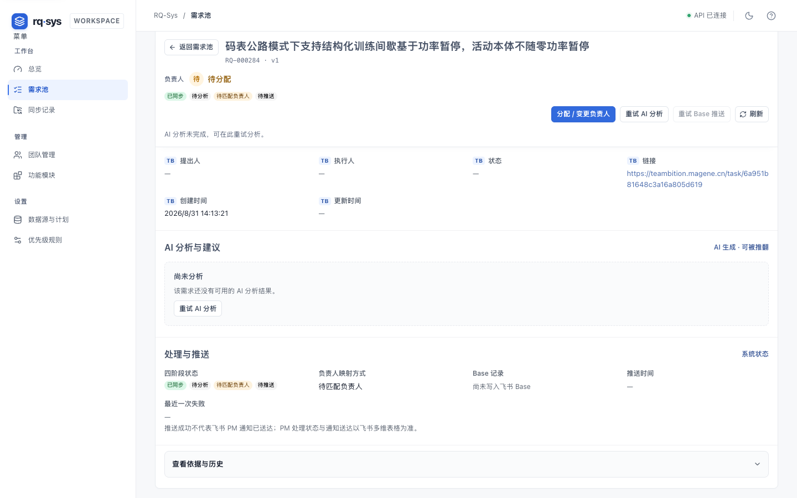
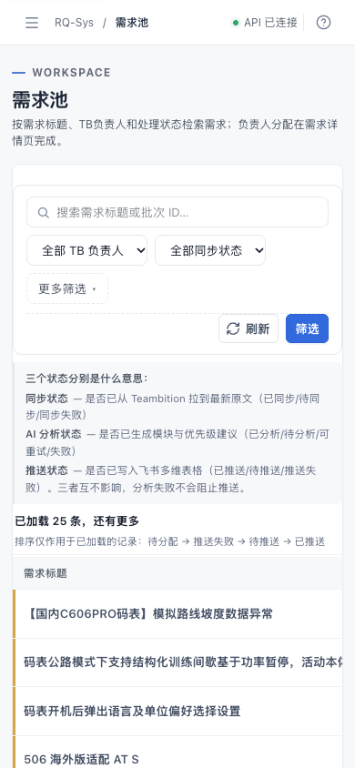
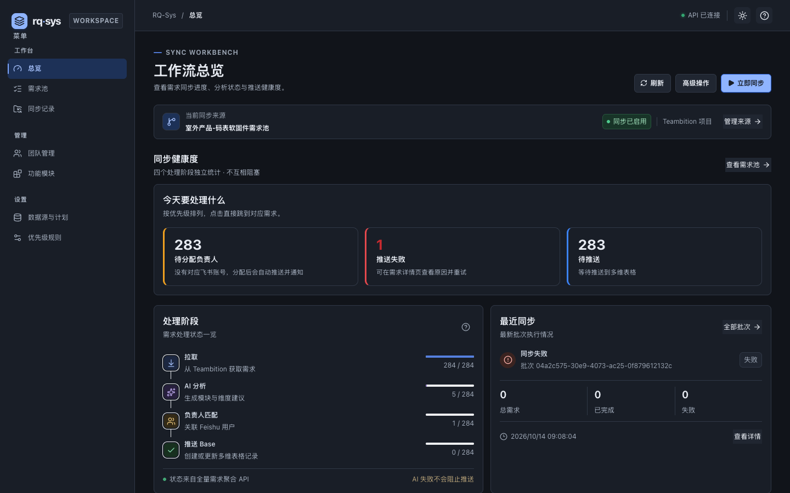

# RQ-Sys 修复与复验记录

- 日期：2026-10-23
- 输入：本仓 [`AUDIT-REPORT.md`](AUDIT-REPORT.md) + `.scratch/rq-sys-v0.2/acceptance/2026-10-23/READ-ONLY-ACCEPTANCE.md`（修改前只读验收）
- 范围：`apps/api`、`apps/web`、`rq-sys-miaoda/server`、`rq-sys-miaoda/client`
- 本轮约束：未部署、未对目标数据库执行迁移、未触发真实 Teambition / AI / Base / 通知写入；目标环境验收仍未完成

## 结论

两份报告共同的 **P1 阻断与必修 P2 已在当前工作树修复**，本地两仓重新验证通过：

| 检查 | 结果 |
| --- | --- |
| root API 测试 | **399/399 通过** |
| root Web 测试 | **79/79 通过** |
| miaoda route 测试 | **107/107 通过** |
| root typecheck / build | 通过 |
| miaoda typecheck / build:prod | 通过 |
| 两仓对齐 | 24/24 共用逻辑一致，无未声明漂移 |
| 契约矩阵 | 20 通过 / 0 失败 / 1 警告 / 3 跳过（缺网关/AI 授权，跳过原因不变） |
| miaoda eslint / stylelint | 通过 |
| 真实浏览器复测 | 吸顶、390px 无整页横向溢出、深色数字可读、移动端帮助入口保留 |

**但仍不能把目标环境标记为已验收**：当前最新 Online release 是 `7699766681938496751`（commit `3a1e4fa`，迁移 `0006`/`0007` 已发布），它只包含“同标题自动隔离”的旧行为，不包含本轮修复；本轮没有重新构建/发布，也没有做 Base 通知或重试写入。Online 现状为 315 条需求、27 条疑似重复被隔离、默认池 288 条。详见“剩余阻断”。

## 两份报告如何合并

| 问题 | 两份报告的口径 | 本轮处理 |
| --- | --- | --- |
| 空结果搜索 500 | 两份均列为 P1；只读验收还在 Online 复现了 500 | 修复两仓路由；补真实 people 依赖的空页测试 |
| 批次明细/重试契约 | 两份均列为 P1；只读验收补充了“刷新失败被误报成入队失败” | 统一 `id` 字段；入队成功与刷新失败分开反馈；补测试 |
| 部署端失败项重试 | 只读验收指出 miaoda 无幂等键/审计，root 有 | miaoda 服务端与客户端对齐 root：Idempotency-Key 复用、审计；测试更新 |
| 同标题记录 | 只读验收认为“保留但自动隔离”仍不符合 T15 | 按已确认 T15 改为**标题只作提示**：不再从列表/统计/分析/推送/负责人分配中排除；UI 提示与按钮禁用移除 |
| Base 保留负责人通知 | 只读验收列为 P1（内容变更可能通知 PM Leader） | 内容变更/AI 重试成功时，若本次不覆盖 Base 负责人，读取 Base 当前负责人作为收件人；覆盖时以应用负责人为准 |
| 陈旧行 / 加载态 / 重跑 | 只读验收的 UI P2 | 首屏/筛选失败清空旧行；人员/模块加载与空态分开；已分析记录允许“重新分析” |
| 吸顶 / 深色 / 手机 / 状态 ID / a11y | 本仓审计的 UI 高影响项 | 修复 CSS token、`overflow-x: clip`、表格滚动容器、移动帮助入口、TB 状态只显示名称、ARIA 与键盘焦点 |

## 已修复明细

### 1. P1：空结果搜索不再 500

- 位置：`apps/api/src/http/app.ts`、`rq-sys-miaoda/server/rqsys/http/app.ts`
- 变更：空页时不再调用 `people.listActive("")`；只有存在首条需求时才查人员映射。
- 测试：
  - root `apps/api/src/http/app.test.ts`：空搜索返回 `200 {items:[], nextCursor:null}`，并断言没有用空字符串查 people。
  - miaoda `scripts/rqsys-overview-metrics.test.cjs`：同场景 route 测试。
- 本地真实 API 复测：`GET /api/requirements?q=zzz-no-such-20261023` → `200 {"items":[],"nextCursor":null}`（此前 500）。

### 2. P1：批次明细与失败项重试

- 位置：`apps/web/src/api.ts`、`apps/web/src/panels.tsx`；`rq-sys-miaoda/client/src/rqsys/api.ts`、`panels.tsx`
- 变更：
  - `BatchDetail` 改用服务端真实字段 `id`，详情头部与刷新不再出现 `undefined`。
  - 重试后的“已入队”成功提示先于刷新；刷新失败只保留旧明细，不再把成功入队覆盖成失败。
- 测试：root `panels.test.tsx` 的批次详情/重试用例更新并通过；本地 API 读取批次详情确认返回 `id`。

### 3. P1：miaoda 失败项重试的幂等键与审计

- 位置：`rq-sys-miaoda/server/rqsys/http/app.ts`、`rq-sys-miaoda/client/src/rqsys/api.ts`、`panels.tsx`
- 变更：
  - 服务端要求并哈希 `Idempotency-Key`，同键复用批次；按 retry batch dedupe key 判断 queued/running/succeeded；写 `sync.item.retry_requested` 审计。
  - 客户端生成并复用按键，刷新失败不误报；与 root 行为对齐。
- 测试：`scripts/rqsys-controller-route.test.cjs` 更新为带键、带 `findByIdempotencyKey` 与 audit fake；source-only 模式仍保持。
- 说明：本轮只做本地路由测试，没有向目标环境提交真实重试。

### 4. P1：同标题记录改为“提示”，不再自动隔离

- 位置：两仓 `adapters/postgres/repositories.ts`、`pipeline/advance.ts`、`server.ts` / `runtime.ts`、`base/push-service.ts`、`http/app.ts`
- 变更：
  - 搜索与指标不再过滤 `duplicate_of_requirement_id`。
  - 同步后的分析入队、孤立 running 恢复、pipeline 推进、Base 推送、负责人分配不再因同标题提示而跳过/拒绝。
  - `duplicateOf` 仍保留在详情 DTO，详情提示改为“仅作疑似重复提示；两条记录按各自来源 ID 独立处理”，不再禁用负责人/分析/推送按钮。
- 依据：V0.2-T15 的已确认口径（来源 ID 是身份，同标题独立保留）；标题只作提示，不删除、不推断丢失数量。
- 测试：
  - `apps/api/src/http/owner-base.test.ts`：同标题提示下仍可分配负责人。
  - `apps/api/src/base/push-service.test.ts`：同标题提示下仍可推送。
  - `apps/api/src/adapters/postgres/repositories.integration.test.ts`：搜索返回两条、统计 total=2。
- 注意：这会增加重复标题记录的 AI 分析与 Base 行数量，这是独立保留的预期代价；目标环境目前有 27 条被隔离的疑似重复记录，下一次发布/同步后它们会进入正常处理，需要产品在发布前确认这 27 条是否按独立需求处理。

### 5. P1：Base 保留负责人参与通知收件人判定

- 位置：两仓 `base/client.ts`、`base/push-service.ts`
- 变更：
  - 新增 `findCurrentOwner`：读取 Base 当前行人员字段，解析 `open_id` / `user_id` / `union_id`；读取失败返回 null，不阻断推送。
  - 内容变更 / AI 重试成功时，如果本次**不会写 Base 负责人**（TB 无负责人或人工负责人已推送过），优先把通知发给 Base 保留的当前负责人；如果本次会覆盖负责人，则以应用负责人为准，避免通知一个即将被替换的人。
  - 读取是惰性的：负责人事件、首次推送、会覆盖负责人的普通推送不额外读 Base。
- 测试：
  - `base/client.test.ts`：`open_id` 人员字段解析。
  - `base/push-service.test.ts`：内容变更、应用无映射、Base 保留负责人 B → 收件人为 B；原有“内容变更通知当前负责人”用例保持通过。
- 目标侧仍需 POC：Base 人员字段真实返回的 ID 形态（open_id / user_id）和通知字段的 `user_id_type` 必须以目标 Base 回读验证，不能仅凭本地 stub。

### 6. UI P2 与高影响项

- **筛选失败陈旧行**：需求池/批次首屏请求失败时清空旧行，避免“旧结果 + 已应用筛选”的误读。
- **加载 vs 空态**：组内人员、功能模块先显示“正在载入…”，不再把加载中显示成“暂无”。
- **重新分析**：已分析记录允许手动“重新分析”（服务端允许 `analyzed` 再入队，创建新分析版本）；不再只对 pending/failed_retryable 开放。
- **规则/模块错误语义**：规则校验失败改为红色 alert，不再用绿色成功条；模块客户端重名改为表单内错误；API 英文错误映射为中文可操作文案。
- **吸顶**：`html/body/#root/.app-shell` 的 `overflow-x: hidden` 改为 `clip`，详情摘要与顶栏恢复 sticky。
- **深色主题**：补齐 5 个历史缺失 token（`--rq-text*`、`--rq-surface-muted`、`--rq-border-subtle`），输入框/表头/说明条/待办数字使用主题变量。
- **手机 390px**：`.table-scroll` 增加定位上下文，避免 `.sr-only` 逃出并撑宽整页；≤560px 只隐藏主题按钮，保留帮助入口。
- **TB 状态**：不再把 `taskflow_status_id` 当作状态名展示；只有名称时显示名称，否则“—”。
- **来源条**：API 读取失败显示“无法读取来源配置”，不再误称“尚未配置”。
- **a11y**：`pipeline-help` 增加 `role="img"`；模块表格滚动区可聚焦并带 region 名称；文字 tertiary token 提升对比度。
- **批次进度**：运行中批次 5 秒有界轮询，终态或页面隐藏时停止。
- **负责人映射**：待匹配需求增加游标“加载更多”，不再固定只看前 25 条。
- **总览搜索**：placeholder 明确为“在当前已加载需求内搜索”，避免被理解为全量搜索。

## 复验证据

### 自动化

```text
root:  npm run typecheck && npm test && npm run build
       npm run check:alignment && npm run check:contract
       → API 399/399；Web 79/79；build 通过；对齐 24/24；契约 20 通过/0 失败/1 警告/3 跳过

miaoda: npm run type:check && npm run test:rqsys-route
        npm run build:prod && npm run eslint && npm run stylelint
        → 107/107；build、eslint、stylelint 全部通过
```

### 真实浏览器（Playwright + Chrome，本地 API + Vite）

- 详情页 1440×900，滚动前 topbar `top=0`、摘要 `top=207.5`；滚动 314px 后 topbar `top=0`、摘要 `top=57` → 吸顶恢复。
- 需求池 390×844：`document.documentElement.scrollWidth=390`，表格在 `.table-scroll` 内横向滚动（`scrollWidth=2339`），帮助入口可见。
- 深色总览：`.todo-value` 计算色 `rgb(231,235,242)`，表头文字 `rgb(161,171,186)`，不再是深字。
- 证据：
  - 
  - 
  - 

### 本地 API 冒烟

- 空搜索 200；overview metrics 200；批次详情返回 `id` 字段（见 `evidence/` 同目录记录）。
- 未执行真实重试/通知写入。

## 剩余阻断与未完成项

1. **本轮修复尚未发布，目标仍是旧行为**
   - 最新 Online release `7699766681938496751`（commit `3a1e4fa`）已包含迁移 `0006`/`0007`，因此不再有“目标缺列”的发布阻断；但它仍是“同标题自动隔离”的版本。
   - 它不包含本轮的 Base 保留负责人通知、重试幂等、重复可见性、空搜索修复和 UI 修复；目标环境仍是 315 条总量、27 条疑似重复、默认池 288 条。
   - 重新发布前需要产品确认：这 27 条是否应按独立需求进入分析/推送，以及是否接受由此新增的 Base 行与通知。

2. **目标环境发布与验收**
   - 本轮没有重新构建/发布；Base 负责人通知、重试幂等、重复可见性、真实 UI 行为都还没有目标环境证据；本地通过 ≠ 目标通过。

3. **V0.2**
   - 本轮只落实了 T15 的“同标题保留/提示”基线，未完成 V0.2 全部 18 张 ticket；手工负责人、重复处理入口等仍需按 ticket 继续。

4. **UI 剩余打磨**
   - 审计日志仍固定 50 条；详情页 H1/重复标题与 AI 卡片的层级问题未重做；app 主包仍约 1.28MB（gzip 400KB）；部署端客户端仍没有主题切换。
   - 只读验收提到的来源计划“周三 09:00”是否符合当前预期，仍需产品确认，本轮未改计划。

5. **目标通知 POC**
   - Base 人员字段 ID 形态与通知字段 `user_id_type` 需要目标环境回读；若实际形态与解析逻辑不符，会回落到应用负责人/PM Leader，而不是静默误发。

## 变更文件（按区域）

- API：`apps/api/src/http/app.ts`、`base/client.ts`、`base/push-service.ts`、`pipeline/advance.ts`、`server.ts`、`adapters/postgres/repositories.ts`
- Web：`apps/web/src/App.tsx`、`api.ts`、`panels.tsx`、`requirement-view.ts`、`styles.css`
- miaoda server：`server/rqsys/http/app.ts`、`base/client.ts`、`base/push-service.ts`、`pipeline/advance.ts`、`server.ts`、`runtime.ts`、`adapters/postgres/repositories.ts`
- miaoda client：`client/src/rqsys/App.tsx`、`api.ts`、`panels.tsx`、`requirement-view.ts`、`styles.css`
- 测试：两个 API/route 测试、Web panels 测试、Base client/push-service 测试、同步/重复集成测试
- 规格/契约：`specs/rq-sys-mvp/01-teambition-sync.md`、`04-workbench.md`、`DB-AND-API-DESIGN.md`、`openapi.yaml`（同标题语义、负责人 409 描述、列表返回说明）
- 审查产物：本文件、`AUDIT-REPORT.md` 顶部修复提示、`evidence/fix-*.png`

## 复现命令

```bash
# root
npm run typecheck
npm --workspace @rq-sys/api run test
npm --workspace @rq-sys/web run test
npm run build
npm run check:alignment
npm run check:contract

# miaoda
cd rq-sys-miaoda
npm run type:check
npm run test:rqsys-route
npm run build:prod
npm run eslint
npm run stylelint
```
